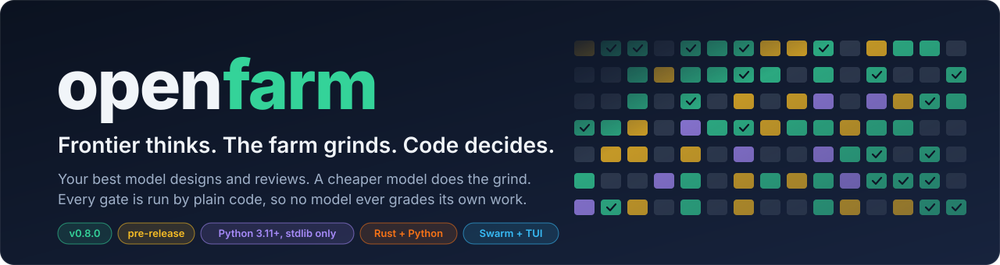
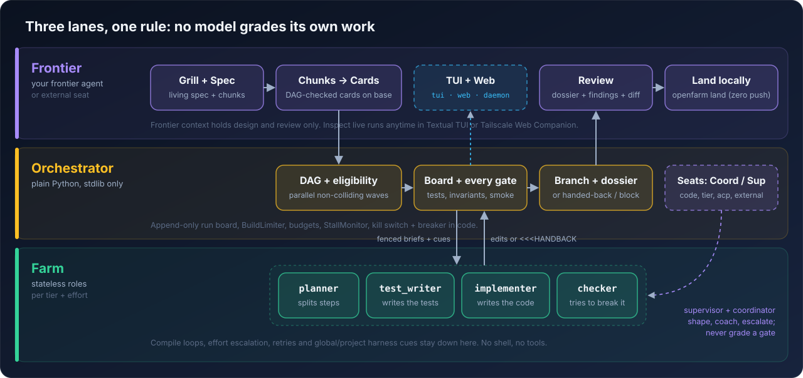

<p align="center">
  
</p>

<h3 align="center">Spend frontier tokens on thinking, not on compile errors.</h3>

<p align="center">
  openfarm gives your best model the work that needs judgement: grilling your idea, fleshing out the living spec &amp; chunks, splitting chunks into cards, and reviewing the result.<br>
  A cheaper model takes the grind: writing the tests, writing the code, and retrying against the compiler and tests within fixed budgets.<br>
  Deterministic Python code runs every gate, the grind never touches your frontier context, and every passing card lands as a clean local branch (zero <code>git push</code>).
</p>

<p align="center">
  
  
  
  
  
  
</p>

<p align="center">
  <a href="#quickstart"><b>Quickstart</b></a> &nbsp;&bull;&nbsp;
  <a href="#the-iterative-loop"><b>Workflow</b></a> &nbsp;&bull;&nbsp;
  <a href="#what-changed-in-v0100v0140"><b>What's new</b></a> &nbsp;&bull;&nbsp;
  <a href="#web-companion-tailscale--daemon"><b>Web &amp; Daemon</b></a> &nbsp;&bull;&nbsp;
  <a href="#commands"><b>Commands (37)</b></a> &nbsp;&bull;&nbsp;
  <a href="#whats-verified"><b>Verified</b></a> &nbsp;&bull;&nbsp;
  <a href="#roadmap"><b>Roadmap</b></a> &nbsp;&bull;&nbsp;
  <a href="docs/HANDOFF.md"><b>Handoff</b></a>
</p>

<p align="center">
  
</p>

> [!IMPORTANT]
> **Pre-release (v0.15.0).** `openfarm_core/` is **100% Python 3.11+ stdlib-only** (`dependencies = []`). An optional Textual workbench (`pip install "openfarm[tui]"`) automatically falls back to the stdlib `curses` TUI when Textual is not installed. Merges are strictly local-only (the core has **no `git push` code path**), and neither the TUI nor the Web Companion displays dollar spend.

---

## Why openfarm

Frontier models are brilliant at product architecture, scoping, and review, and wasteful when left grinding through compile, fix, retry loops. Every failed build they read bloats context and causes context rot. openfarm moves the grind to a cheaper worker model under deterministic code gates and keeps your frontier conversation clean.

<table>
  <tr>
    <td width="33%" valign="top">
      <h3>Think once, iterate cleanly</h3>
      Describe a vague app idea in an empty folder or a feature in an existing repo. Frontier Architect grills you one question at a time, writes a stack-authentic living spec (<code>.openfarm/PROJECT_SPEC.md</code>), splits it into ordered chunks (<code>.openfarm/CHUNKS.json</code>), and slices each chunk into scoped runnable cards.
    </td>
    <td width="33%" valign="top">
      <h3>Grind out of sight</h3>
      A cheaper worker model works each card in an isolated git worktree — in the foreground, via the Textual TUI, or detached via <code>openfarm daemon start</code>. Compiler loops, retries, revert checks, counter-tests, invariants, and runtime smoke checks run inside fixed budgets outside frontier context.
    </td>
    <td width="33%" valign="top">
      <h3>Trust code, not claims</h3>
      No model certifies its own work. Plain Python enforces every gate, workers get no shell and no tools, and edits only touch files a card allows. Review a compact dossier and diff in the TUI, CLI, or Tailscale Web Companion, and land locally.
    </td>
  </tr>
</table>

---

## From an idea to a running app

Run `openfarm` in a folder, empty or not. One screen takes you through seven steps, and always shows the one thing
that is yours to do next. The same steps, in the same words, are what the agent skills (`/openfarm-initialize`)
and the CLI follow.

<p align="center">
  
</p>

| Step | What happens | Your one action |
| --- | --- | --- |
| **1. Idea** | You say what you want to build, in a sentence or a full spec, and pick a stack (or let it be worked out). The text is saved as you type. | **Continue** |
| **2. Questions** | The Architect (a frontier model) asks a few questions, one at a time, each with suggested answers and a line on why it matters. If it can't be reached, the screen says why and offers Retry. | **Answer** |
| **3. Spec** | A spec you can read in full, split into ordered **goals**. Change it in words, or edit it in `$EDITOR`. | **Plan goal 1** |
| **4. Plan** | The current goal is split into **tasks**. Before you see them they are checked (can each be scaffolded, does each list every file it names, does the order work, do files that must agree name the same things). What can be repaired is repaired and shown; what can't is held back with the reason. | **Build N tasks** |
| **5. Build** | Lesser models build the tasks in a background service: tests first, then code, then a row of checks. Closing the window does not stop it. Each task shows its state in a sentence. A task that stopped says which of three things went wrong (the task is wrong, the builder fell short, or a check may be wrong) and offers the action that fits. | **Accept W1-02** (merges it locally, never pushes) |
| **6. Try it** | When every task of the goal is accepted, the app is started and looked at: screenshots at desktop and phone size, and checks that what the goal promises can actually be seen. | **Fix this**, or **Looks right** |
| **7. Accept** | The goal's summary: tasks, tests, what trying it showed. | **Accept goal 1**, which moves on to the next goal's plan |

Something not right after that? **Something's wrong…** turns what you say into fix tasks under the same goal.
**New feature…** adds a goal. Nothing already built is thrown away, and the record of what was decided only grows.

Words used here and their older names, which the CLI and file names still use: a **task** is a card, a **goal** is a
chunk, a **plan** is a wave plan, **questions from builders** are findings, and **accept** covers what used to be
approve, land and merge.

---

## Quickstart

### 1. Install

With the optional Textual TUI workbench:

```bash
git clone https://github.com/grandprixgp/openfarm
cd openfarm
pip install -e ".[tui]"
```

Or zero-dependency install (stdlib `curses` TUI + CLI + Web Companion + agent skills):

```bash
git clone https://github.com/grandprixgp/openfarm
cd openfarm
python3 -m openfarm_core.cli install-skill --target all --install-bin ~/.local/bin --json
```

This deploys `/openfarm-grill-me`, `/openfarm-initialize`, and `openfarm` for Claude Code (`$CLAUDE_CONFIG_DIR`, default `~/.claude`), Antigravity (`~/.gemini/config`), Codex (`$CODEX_HOME/skills`), and `.agents/`, plus an optional `openfarm` launcher on your `PATH`.

### 2. Configure Frontier & Worker providers once (global)

Launch bare `openfarm` inside any directory (empty or existing) to open the guided Textual Workbench:

```bash
openfarm
```

Or configure providers from the CLI:

```bash
openfarm acp status --json                  # inspects Claude, Codex & Antigravity (never starts agy)
openfarm acp login --provider claude        # OAuth login for Frontier Architect & Supervisor
openfarm providers set \
  --preset custom \
  --endpoint https://api.commandcode.ai/provider/v1 \
  --model deepseek/deepseek-v4.1-flash      # stores key at mode 0600 in ~/.config/openfarm/worker.key
openfarm providers probe                    # live /models check with x-cmd-zdr: 1
```

Global settings live in `~/.config/openfarm/providers.toml` (mode `0600`; raw keys live separately in `key_file`) and are inherited automatically by newly initialized projects, including `headers = { "x-cmd-zdr" = "1" }` when ZDR is enabled.

### 3. Build or adopt a project

- **The screen (recommended):** run `openfarm` in the project folder and follow the steps above. Projects,
  providers, settings and the older screens are behind `Ctrl+K`; `b` shows every task on a board.
- **Greenfield CLI:**
  ```bash
  openfarm init my-web-app --lang typescript --idea "Focus timer web app with presets" --commit
  openfarm doctor --probe
  ```
- **Existing repository (Rust, Python, TypeScript, or Go):**
  ```bash
  openfarm adopt --dir .                    # auto-detects stack, runs suite once, proposes known_failing
  openfarm doctor
  openfarm plan                             # view topological DAG tiers & parallel batches
  openfarm run --cards 3
  ```

> [!NOTE]
> **Requirements:** Python 3.11+ and `git`. Rust repos need `cargo`, `clippy`, `rustfmt` (optional `cargo-mutants`). TypeScript repos need `node` (`node --test`, `vitest`, or `jest`; optional `tsc` and `prettier`). Python repos use `unittest` or `pytest` (optional `ruff`). Go repos use `go test`, `go vet`, `gofmt`. Codex and Antigravity children use bubblewrap (`bwrap`) under `[micromanager] confine = "auto"`.

---

## Web Companion, Tailscale & Daemon

Run waves unattended in the background and monitor/review them from any device on your Tailnet (laptop, desktop, phone):

### Detached Factory Daemon (`openfarm daemon`)

```bash
openfarm daemon start --cards 5             # detached OS session; logs to <state_dir>/daemon.log
openfarm daemon status                      # PID liveness + zombie detection
openfarm daemon logs --tail 80
openfarm daemon stop                        # drops kill-switch + SIGTERM process group
```

The screen's **Build** button starts the same background service, so a build keeps going when the window closes, and reopening `openfarm` shows it again.

### Stdlib Web Companion & Tailscale (`openfarm web`)

`openfarm_core/web.py` serves a zero-dependency dark high-contrast single-page UI (Spec Chunks, Wave Cards + Approve/Land, Findings Inbox, Adaptive Routing, live SSE activity log, token split, zero `$` spend):

```bash
# Localhost only (default, safest)
openfarm --repo ~/projects/my-app web --port 8787

# Recommended for Tailscale: keeps server on 127.0.0.1:8787 and exposes HTTPS on your tailnet
openfarm --repo ~/projects/my-app web --tailscale --port 8787
# -> https://<your-node>.ts.net:8787/   (disable with: tailscale serve --https=8787 off)

# Direct Tailscale IPv4 bind (without tailscale serve)
openfarm --repo ~/projects/my-app web --bind tailscale --port 8787
```

Security defaults:
- Binds strictly to `127.0.0.1` unless `--bind` is set; refuses `0.0.0.0` / `::` unless `--allow-all-interfaces` is passed explicitly.
- Generates a per-session random `X-Openfarm-Token` and rejects any mutating `POST /api/...` without it (`403 Forbidden`).
- Strictly local merges only — never pushes to git remotes.

---

## What changed in v0.10.0–v0.15.0

- **`v0.15.0` — One screen, one home for tasks, try it:**
  - **One screen** (`openfarm_tui/journey.py`) replaces the five tabs: a journey rail (Idea, Questions, Spec, Plan, Build, Try it, Accept), the one thing in front of you, one main button that Enter presses, a fixed activity strip, and two themes. Which step shows is worked out from the project's state (`openfarm_tui/journey_state.py`), so reopening lands where the project is. The older screens are behind `Ctrl+K`.
  - **Tasks, the spec and the decisions log live in one place**, the `openfarm-cards` branch, and every change goes through one function that records who changed what and why (`openfarm_core/store.py`, `openfarm card add|show|history|skip|migrate`). Nothing is written to `cards/` or `.openfarm/PROJECT_SPEC.md` on your main branch any more; an older project is moved over once with `openfarm card migrate`, which shows any task whose two copies differ and waits for your choice.
  - **Plan checks** (`openfarm_core/preflight.py`) run before a plan is shown: scaffolding, files named but not listed, order, and shared names two tasks must agree on. Repairs are shown with their reason; a task that still fails is held back, not built.
  - **A stopped task says what kind of stop it is** (`openfarm_core/blocked.py`): the task is wrong (apply a shown fix and retry), the builder fell short (retry), or a check may be wrong (run it yourself and see the raw output).
  - **Try it** (`openfarm_core/tryit.py`, `openfarm try`): starts the app, takes desktop and phone screenshots with a headless Chromium, and checks that what the goal names can be seen, not merely that it is in the page.
  - **Iteration keeps what exists**: "Something's wrong" becomes fix tasks under the current goal, "New feature" adds a goal, and task numbers are never reused.
  - **Builds belong to the background service** and `openfarm run --follow` carries one build through tasks that wait on each other.
  - Words: task, goal, plan, build, accept in the UI and help; `card`, `chunk` and `wave` stay in file names and commands.

- **`v0.14.0` — Detached Daemon, Tailscale Web Companion & Notifications:**
  - `openfarm daemon {start,stop,status,logs}` (`openfarm_core/daemon.py`) + TUI detached controls & `● DAEMON` pill.
  - `openfarm web [--tailscale] [--bind 127.0.0.1|tailscale] [--port 8787]` (`openfarm_core/web.py`): stdlib HTTP + SSE + per-session CSRF token + first-class `tailscale serve` HTTPS & `tailscale ip -4` integration.
  - Optional `[notifications]` config table (`openfarm_core/notify.py`) for webhook JSON POSTs and desktop `notify-send` alerts with event filtering.
- **`v0.13.0` — Conversational Frontier Architect, Spec & Chunks, Live Architect Log, Adaptive Router & Timeline:**
  - Replaced rigid 3-box Rust-biased Grill with **Idea → Conversational Grill → Living Spec & Ordered Chunks (`.openfarm/CHUNKS.json`) → Split Chunk into Cards → Iterate**.
  - Stack-authentic Architect prompts (authentic runnable TypeScript/Web apps instead of Rust `Result<T, DomainError>` libraries), deterministic `.js → .ts` relative import auto-repair, and automatic placeholder modules for brand-new card `touches` files.
  - Always-visible shared **Live Architect Progress Banner & Streaming Log** (`#architect-panel`, `#architect-log`) across Studio sub-views with `[MM:SS]` timer, 15s heartbeats, and file-by-file write progress.
  - **Adaptive Model Router** (`openfarm routing`, `openfarm_core/routing.py`) & **Attempt Timeline / Phase-B Resume Inspection** (`openfarm timeline <CARD>`, `openfarm_core/timeline.py`), plus `Spec` and `Routing` tabs in `4 Engine`.
  - Global provider `endpoint` + `x-cmd-zdr: 1` header inheritance in `init` and `load_config`.
- **`v0.12.0` — Architectural Invariants, Runtime Acceptance & Golden Replay Vault:**
  - `[invariants]` deterministic gate (`forbidden_imports`, `max_file_bytes`, `require_exports`; `openfarm_core/invariants.py`).
  - `[acceptance]` runtime "Proof-of-Life" CLI & ephemeral loopback HTTP `{PORT}` smoke gate (`openfarm_core/acceptance.py`).
  - `openfarm replay {list,add,run}` Golden Replay Vault (`openfarm_core/replay.py`).
- **`v0.11.0` — Cards-as-the-DAG & Autonomous Integration Branch:**
  - `openfarm plan` topological DAG planner with `wave` + `depends` ordering, cycle detection (`cyclic-dag`), and parallel batches (`openfarm_core/dag.py`).
  - Deterministic trial-rebase (`openfarm_core/factory.py`, `StopCode.REBASE_CONFLICT`) and opt-in `[factory] auto_land` onto local `openfarm/integration` (`openfarm land --promote-integration`).
- **`v0.10.0`–`v0.10.2` — Textual Workbench, Global Providers & Projects Registry, Factory Ergonomics:**
  - Optional `openfarm_tui/` Textual workbench (`0 Projects`, `1 Studio`, `2 Review`, `3 Findings`, `4 Engine`, `Ctrl+K` Palette) with automatic stdlib `curses` fallback.
  - Global `providers.toml` (`openfarm providers {status,set,probe}`) & global `projects.toml` (`openfarm projects {list,add,edit,remove,discover}`, strictly non-destructive to project files on disk).
  - In-TUI Card Editor & Split, deduplicated Findings Inbox + Wave Synthesis, Touches Conflict Matrix, and `openfarm doctor [--fix] [--probe]`.

<details>
<summary><b>Earlier releases (v0.8.0–v0.9.2)</b></summary>

- **v0.9.0–v0.9.2:** `[gates] counter_tests = "reject"` default, named supervision profiles (`--profile lean|balanced|strict`), `openfarm review`, local serial merge queue (`openfarm land`), Go language pack (`openfarm_core/packs/go.py`), TypeScript `vitest`/`jest` support, polyglot per-unit languages (`[units.<name>]`), `openfarm auto`, `openfarm triage`, `openfarm frontier-review`, and high-contrast stdlib `curses` Automode TUI. Build logs: [`v0.9.0`](docs/v0.9.0-build-log.md), [`v0.9.1`](docs/v0.9.1-build-log.md), [`v0.9.2`](docs/v0.9.2-build-log.md).
- **v0.8.5–v0.8.8:** Lean supervisor prompts & compact payloads, merged `shape_and_scaffold`, conditional supervision (`shape_when`, `pre_review_when`), default `medium → high → max` retry effort ladder, fresh-vs-cached token accounting, changed-line mutation for Python/TypeScript and `--in-diff` `cargo-mutants` for Rust, opt-in runner bubblewrap confinement (`[runner] confine = "bwrap"`, `confine_network = "on"`), pre-review Done-text rule, and pre-freeze test linting. Build logs & benches: [`bench-v0.8.7.md`](docs/bench-v0.8.7.md), [`bench-v0.8.8.md`](docs/bench-v0.8.8.md), [`pilot-v0.8.6.md`](docs/pilot-v0.8.6.md).
- **v0.8.0–v0.8.1:** Swarm board (`board.jsonl`), model tiers & effort (`[tiers.*]`), parallel non-colliding cards, `StallMonitor`, `codex-acp` & `antigravity-acp`, `openfarm drive`, TypeScript pack, global harness memory, and efficacy bench (`openfarm bench`).

</details>

---

## How it works

<p align="center">
  
</p>

| Lane | Who | Does | Never does |
| --- | --- | --- | --- |
| **Frontier** | Claude / Codex / Antigravity ACP, or you | Grill, living spec & chunks, runnable vertical slice, card decomposition, optional supervision, review & local land | Compile/retry grind |
| **Orchestrator** | Plain Python (`openfarm_core/`) | Claims cards, enforces eligibility & DAG, builds fenced briefs, applies edits, runs every deterministic gate, writes dossiers & telemetry | Push to remotes (`git push` does not exist in core) |
| **Farm** | Non-frontier worker models | Splits cards into steps, writes failing named tests, implements code, writes counter-tests | Run shell commands, touch files outside card scope, see `never_touch` files, certify gates |

### Per-card deterministic pipeline

<p align="center">
  
</p>

1. **Claim, DAG & eligibility:** card is hashed and checked against eligibility rules, `never_touch`, and `depends`.
2. **Isolate:** dedicated local branch (`openfarm/<CARD>-<slug>`), worktree, and per-card build directory.
3. **Baseline green:** suite runs twice on base (cached across unchanged base commits); red or flaky bases refuse up front.
4. **Shape & scaffold (optional):** Frontier micromanager clarifies ambiguities and scaffolds throwing contracts.
5. **Phase A (tests):** worker writes named tests that compile, lint/format cleanly, and **fail on base** before being frozen by hash.
6. **Phase B (code):** implementer edits only `touches` files, escalating effort on retries (`medium → high → max`).
7. **End gates:** pass-after twice, full suite, workspace lint, banned patterns, no test loss, tests-frozen, revert check, architectural invariants (`[invariants]`), runtime acceptance (`[acceptance]`), golden replays, optional mutation, two-pass checker + counter-tests, optional pre-review.
8. **Catch-up & harness capture:** throwaway trial-merge/rebase against base + bounded Harness² lesson capture (`propose → probe → confirm`).

### Architecture & safety boundaries

<p align="center">
  
</p>

| Boundary | Enforcement |
| --- | --- |
| **Zero `git push`** | All git operations flow through `openfarm_core/git.py`; `push` is blocked by allowlist and dangerous git flags/config overrides are refused. |
| **Never-touch & forbidden files** | Symlink-resolved globs enforced at eligibility and every diff; `.openfarm/**` and `.claude/**` are always forbidden to the farm. |
| **Endpoint allowlist & secrets** | Model backend refuses non-allowlisted endpoints/redirects; keys live outside the repo at mode `0600` and are never logged. |
| **Fenced untrusted data** | Card text, diffs, test output, and repo files are fenced as data with control sequences stripped. |
| **Provider & runner confinement** | Isolated homes + cleaned env for ACP children; optional `bwrap` confinement (`[micromanager] confine`, `[runner] confine`, `confine_network = "on"`). |
| **Web Companion loopback + CSRF** | Binds `127.0.0.1` by default (wildcard refused without `--allow-all-interfaces`); all mutating POST routes require per-session `X-Openfarm-Token`. |

---

## Commands

One `openfarm` CLI with **37 subcommands**, shared exit codes (`0` ok, `1` refused/ineligible, `2` usage/config error, `3` trouble/infra), and `--json` parity on every command.

### Setup, Auth & Multi-Project

| Command | Purpose |
| --- | --- |
| `openfarm init NAME` | Scaffold a new Rust, Python, TypeScript, or Go repo (`--lang`, `--idea`, `--acp-provider`, `--commit`), inheriting global providers + ZDR headers |
| `openfarm adopt` | Adopt an existing Rust, Python, TypeScript, or Go repository with baseline verification (`--lang`, `--no-suite`) |
| `openfarm providers [status\|set\|probe]` | Inspect, save (`0600`), or live-probe global Frontier & Worker settings (`~/.config/openfarm/providers.toml`) |
| `openfarm projects [list\|add\|edit\|remove\|discover]` | Manage global Openfarm project registry (`~/.config/openfarm/projects.toml`); `remove` never touches project files on disk |
| `openfarm acp [status\|login\|configure\|probe]` | Check logins & confinement, run OAuth login, configure `.openfarm/config.toml`, or run a zero-token ACP handshake |
| `openfarm doctor [--fix] [--probe]` | Preflight health check across git, ACP OAuth, Worker key/endpoint, `bwrap`, toolchains, and stale locks |
| `openfarm install-skill` | Deploy bundled skills, slash commands, plugin, and optional `openfarm` bin shim |

### Run, Plan, Web & Daemon

| Command | Purpose |
| --- | --- |
| `openfarm` / `openfarm auto` / `openfarm tui` | Launch the interactive Textual Workbench (`--curses` for stdlib fallback, `--once` for snapshot) |
| `openfarm plan [--draft]` | Display Cards-as-the-DAG topological tiers, parallel batches, and cycle checks (or draft a wave plan) |
| `openfarm card [add\|show\|history\|skip\|migrate]` | Add, read and drop tasks where they live (the cards branch), see who changed one and why, or move an older project's cards and spec off `main` |
| `openfarm try [--goal C1]` | Try it: start the app, screenshot it at desktop and phone size, and check the goal's content can be seen |
| `openfarm check CARD [--baseline]` | Verify card eligibility, configured tooling, and optional green baseline |
| `openfarm run` | Execute Ready cards (`--follow` to carry on into tasks that were waiting, `--cards`, `--card`, `--spend`, `--profile lean\|balanced\|strict`, `--for`, `--until`, `--dry-run`) |
| `openfarm daemon [start\|stop\|status\|logs]` | Run and manage a detached background `openfarm run` session (`<state_dir>/daemon.log`) |
| `openfarm web [--tailscale] [--bind HOST] [--port 8787]` | Serve the stdlib Factory Companion Web UI (loopback by default; `--tailscale` exposes HTTPS via `tailscale serve`; `--bind tailscale` binds tailnet IPv4) |
| `openfarm status` | Show farm, card queue, and harness-memory status |
| `openfarm pause` / `resume` / `stop` | Pause/resume claims, clear circuit breaker or kill switch, or stop an active run |

### Review, Verification & Telemetry

| Command | Purpose |
| --- | --- |
| `openfarm triage [CARDS...]` | Score card complexity (`low`/`medium`/`high`/`split`) and recommend supervision profiles |
| `openfarm review` | Interactive (or `--json`) wave review of `in-review` cards, diffs, and dossiers |
| `openfarm land CARD... [--promote-integration]` | Local-only serial merge queue (trial-merge/rebase + full test gate + `git merge --no-ff` + cleanup; zero push). `--accept-blocked --note "what I checked"` lands a blocked card a person has checked, recording who and why |
| `openfarm findings [list\|pick\|dismiss\|fold]` | Manage worker-filed findings inbox across waves |
| `openfarm frontier-review` | Mixture-of-Frontiers review across multiple providers (`--providers claude,codex`) |
| `openfarm dossier CARD` | Print a card's reviewer dossier as Markdown or JSON |
| `openfarm verdict CARD VERDICT` | Record review outcome (`clean`, `minor-fix`, `bounced`, `scrapped`) and review tokens |
| `openfarm done CARD` / `release CARD` / `escape CARD` | Mark a locally merged card done, release a blocked card, or log a post-review escape |
| `openfarm replay [list\|add\|run]` | Manage and run Golden Replay regression tests |
| `openfarm routing` | Show empirical model/effort/profile routing recommendations from historical card runs |
| `openfarm timeline CARD` | Inspect run-by-run attempts, gates, stop codes, and Phase-B resume eligibility |
| `openfarm supervise` | Bounded micromanager triage of blocked cards or queue preparation |
| `openfarm harness` | Inspect or curate project and global Harness² memory (`status`, `index`, `show`, `promote`, `demote`, `reset --yes`, `--global`) |

### Swarm, Board, Drive & Bench

| Command | Purpose |
| --- | --- |
| `openfarm board [read\|post\|answer\|wait]` | Read or interact with a live run's append-only swarm board |
| `openfarm swarm [status\|tiers\|join\|start\|set\|hint\|block\|remove]` | Inspect tiers/roster or act as external coordinator/supervisor |
| `openfarm drive` | Drive external coordinator/supervisor seats headlessly with `claude`, `codex`, or `agy` |
| `openfarm bench [list\|run]` | Run the 12-task efficacy bench (`--dry-run` or live farm vs. solo arms in [`bench/arms/`](bench/arms/)) |

---

## Configuration

Each repository carries `.openfarm/config.toml` on its base branch (`openfarm init` / `openfarm adopt` writes a validated one). Unknown tables or keys are rejected so a typo can never silently disable a gate.

<details>
<summary><b>All 20 config tables, budgets and extension hooks</b></summary>

<br>

**Tables (`21`):** `[project]`, `[adapters]`, `[model]`, `[policy]`, `[eligibility]`, `[brief]`, `[runner]`, `[budget]`, `[gates]`, `[cards]`, `[micromanager]`, `[state]`, `[harness]`, `[swarm]`, `[tiers.*]`, `[units.*]`, `[factory]`, `[invariants]`, `[acceptance]`, and `[notifications]`, `[try]`.

- **Polyglot units (`[units.<name>]`):** set per-unit `language = "rust" | "python" | "typescript" | "go"`.
- **Factory auto-land (`[factory]`):** opt-in `auto_land = true`, `integration_branch = "openfarm/integration"`, `auto_land_profiles`, `require_zero_findings`, `require_frontier_consensus`.
- **Architectural invariants (`[invariants]`):** declarative `forbidden_imports`, `max_file_bytes`, and `require_exports` rules enforced deterministically.
- **Runtime acceptance (`[acceptance]`):** declarative CLI and ephemeral loopback HTTP `{PORT}` smoke checks with process-group cleanup.
- **Notifications (`[notifications]`):** optional `webhook_url`, `desktop = true|false`, and `events` filter.
- **Try it (`[try]`):** optional. `start = "npm start"` (a web app, told its port through `PORT`), `port`, `path = "/"`, or `sample = "python3 app.py --demo"` for an app with no page. Without it the language pack works out how to start the app.
- **Budgets & hooks:** per-card attempt/build/token/wall-clock caps, spend caps, circuit breaker, kill switch, `[[gates.extra]]`, `[runner.env]`, and `[brief] test_conventions`.

Full schema, stop codes, and record formats are in [`docs/USAGE-AND-FIRST-DEPLOYMENT.md`](docs/USAGE-AND-FIRST-DEPLOYMENT.md) and [`docs/openfarm-internals.md`](docs/openfarm-internals.md).

</details>

---

## What's verified

### Offline test suite (v0.14.0, Python 3.14 on Linux)

- **1,708+ offline tests** (`0` failures; skips only when optional host tools such as `tsc`, `prettier`, `ruff`, `cargo-mutants`, or `bwrap` are absent).
- Covers wheel packaging + bundled skill assets, all 4 language packs (Rust, Python, TypeScript, Go), Textual + `curses` TUIs, Projects & Providers registries, DAG planner, trial-rebase & auto-land, Invariants/Acceptance/Replay gates, Conversational Architect + Spec/Chunks flow, Adaptive Router & Timeline, Detached Daemon, Web Companion (SSE + CSRF + Tailscale helpers), Notifications, Swarm/Board/Drive, and all 12 scripted bench tasks.

### Live end-to-end verification

- **v0.14.0 Live Dogfood (20 Nov 2026, TypeScript/Web):**
  - Fresh repo (`pulse-app`): `init` (inherited Command Code + `x-cmd-zdr: 1`) → `doctor ok=True` → live Claude ACP Grill → Spec & 3 Chunks → 4 DAG-tiered Wave 1 Cards (`eligibility_ok=True`, `baseline_ok=True`, clean git, `0` `.rs` files) → live Web Companion HTTP/SSE → live DeepSeek V4.1 Flash Worker + Claude ACP Supervisor passing **22/22 deterministic gates** (`W1-01 ✓ in-review`, **77% worker / 23% supervisor**) → live `routing` & `timeline` telemetry.
  - **Live Tailscale HTTPS (`20 Nov 2026`):** `tailscale serve --bg --https=8787 http://127.0.0.1:8787` verified serving live `/api/state` over a private tailnet HTTPS URL (`https://<your-node>.ts.net:8787/`).
- **v0.13.0 Live Dogfood (20 Nov 2026, TypeScript/Web):** Live Claude ACP Grill (tailored product question, 4 options, zero Rust boilerplate) → 145-line authentic web app spec (*Lumen*) + 4 Chunks + 4 Wave 1 cards + 23 passing baseline tests.
- **v0.8.7 144-run Live Bench (19 Nov 2026, [`docs/bench-v0.8.7.md`](docs/bench-v0.8.7.md)):** 12 tasks × 3 repeats, DeepSeek V4.1 Flash workers on Command Code (`x-cmd-zdr: 1`):
  - Claude: farm **35/36** vs solo **34/36**, **37.5% fewer** frontier tokens (worker share 65.3%), 0 false pre-review bounces.
  - Codex: farm **34/36** vs solo **36/36**, **45.9% fewer** frontier tokens (worker share 55.6%), 0 false pre-review bounces.
- **v0.8.6 25-card Rust Pilot ([`docs/pilot-v0.8.6.md`](docs/pilot-v0.8.6.md)):** 0 escapes across `dtolnay/semver`, moving 78–95% of frontier tokens off the frontier model.

## Not yet tested

> [!WARNING]
> - Live execution against real `go`, `vitest`, and `jest` binaries (offline-tested via stand-ins).
> - Live desktop `notify-send` alerts on a GUI desktop session (webhook POSTs verified against live local HTTP server).
> - Everything Antigravity (`agy`) unattended (never run `agy` unattended here).
> - A completed turn through standalone `codex-acp` 0.16.0 on a ChatGPT login (use `binary = "codex-exec"`).
> - Hosted worker endpoints other than Command Code (presets and live `/models` probe are tested; full multi-card waves have run on Command Code).

---

## Roadmap

- [x] **v0.8.0–v0.8.8:** Swarm board, tiers & effort ladder, parallel non-colliding cards, multi-provider ACP & `drive`, bubblewrap confinement, changed-line mutation, lean supervision, 144-run bench & 25-card Rust pilot.
- [x] **v0.9.0–v0.9.2:** `counter_tests = "reject"` default, named profiles, `openfarm review` & local `openfarm land`, Go pack, TypeScript `vitest`/`jest`, polyglot `[units.*]`, `triage`, `frontier-review`, and high-contrast `curses` Automode TUI.
- [x] **v0.10.0–v0.10.2:** Optional Textual workbench (`0 Projects`..`4 Engine`), global Providers & Projects registries, workspace discovery, in-TUI Card Editor/Split, Findings Inbox + Wave Synthesis, Touches Conflict Matrix, and `openfarm doctor`.
- [x] **v0.11.0:** Cards-as-the-DAG (`openfarm plan`), deterministic trial-rebase, and opt-in `[factory] auto_land` onto local `openfarm/integration`.
- [x] **v0.12.0:** Architectural Invariants (`[invariants]`), Runtime Acceptance (`[acceptance]`), and Golden Replay Vault (`openfarm replay`).
- [x] **v0.13.0:** Iterative **Idea → Grill → Living Spec & Chunks → Cards → Iterate** workflow, stack-authentic prompts, shared Live Architect Log, Adaptive Model Router (`openfarm routing`), and Attempt Timeline (`openfarm timeline`).
- [x] **v0.14.0:** Detached Factory Daemon (`openfarm daemon`), Stdlib Web Companion with SSE, CSRF & Tailscale (`openfarm web --tailscale`), and optional Notifications (`[notifications]`).
- [ ] **v0.15+ / v1.0:** Multi-repo fleet dashboard in Web Companion, automatic Phase-B frozen-test resume execution, live `go`/`vitest`/`jest` smoke verification, and public licence + release packaging.

## Contributing

Keep `openfarm_core/` strictly Python 3.11+ standard library only (`dependencies = []`), keep project-specific behaviour in config and adapters, and include offline tests. Run the suite from the repository root with `python3 -m unittest discover -s tests -t .`.

## Licence

<!-- TODO(maintainer): choose a licence, add a LICENSE file, and replace this section. -->

Licence to be decided. Until a licence is added, no rights to use, copy or modify this code are granted.

---

<p align="center">
  <sub>Built by <a href="https://github.com/grandprixgp">@grandprixgp</a>. Frontier thinks. The farm grinds. Code decides.</sub>
</p>
