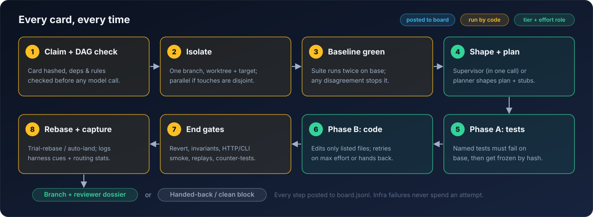

<p align="center">
  
</p>

<h3 align="center">Spend frontier tokens on thinking, not on compile errors.</h3>

<p align="center">
  openfarm gives your best model the work that needs judgement: the architecture, the card design and the final review.<br>
  A cheaper model takes the grind: writing the tests, writing the code, and retrying against the compiler and the tests within fixed budgets.<br>
  The gates are run by plain code, the grind never touches your frontier context, and every card comes back as a reviewable branch or an honest "blocked".
</p>

<p align="center">
  
  
  
  
  
  
</p>

<p align="center">
  <a href="#quickstart"><b>Quickstart</b></a> &nbsp;&bull;&nbsp;
  <a href="#how-it-works"><b>How it works</b></a> &nbsp;&bull;&nbsp;
  <a href="#commands"><b>Commands</b></a> &nbsp;&bull;&nbsp;
  <a href="#whats-verified"><b>What's verified</b></a> &nbsp;&bull;&nbsp;
  <a href="#roadmap"><b>Roadmap</b></a> &nbsp;&bull;&nbsp;
  <a href="docs/openfarm-internals.md"><b>Internals &amp; spec</b></a>
</p>

<p align="center">
  
</p>

> [!IMPORTANT]
> **Pre-release (v0.8.0).** The core is covered by a 704-test deterministic suite (with v0.8 adding shared message boards, named `[tiers.*]` / `effort`, parallel non-colliding cards, worker hand-back, coordinator/supervisor seats, `StallMonitor`, humanized CLI formatting, and the split-pane stdlib TUI; when `[swarm] enabled = false` runs behave identically to v0.7). Previously, v0.6 and v0.7 were partly built by openfarm itself: 19 cards on its own repository, worked live by a cheap worker model with Claude supervising, reviewed and merged. On 17 Nov 2026, live v0.8 QA against Command Code (`deepseek/deepseek-v4.1-flash`, `x-cmd-zdr: 1`) and Claude ACP OAuth exercised `tier:dsf` all-seats runs, `reasoning_effort` comparisons (`low`/`high`/`max`), an external coordinator+supervisor run, concurrent Rust `cargo` builds, a 2-project global lesson exchange, and a 2-task x 1-repeat `openfarm bench` spot check (`farm` 1/2 vs `solo` 1/2). That validates the pipeline end to end, not statistical efficacy — the full 12-task x 3-repeat benchmark and 25-card pilot remain **untested**; see [Not yet tested](#not-yet-tested).

---

## Why openfarm

Frontier models are brilliant at architecture and review, and wasteful when you leave them grinding through compile, fix, retry. Every failed build they read is context they carry forward, and a long session full of stale attempts makes their later work worse (context rot). openfarm moves the grind somewhere cheaper and keeps the frontier conversation clean.

<table>
  <tr>
    <td width="33%" valign="top">
      <h3>Think once</h3>
      Your frontier model writes a protected invariants file, one clean golden reference slice and a queue of small, precisely specified cards. Then it steps back until there is something worth reviewing. The design target is roughly 3k to 8k frontier tokens for all of that, review included.
    </td>
    <td width="33%" valign="top">
      <h3>Grind out of sight</h3>
      A non-frontier model works each card, and the farm is built to run unattended, overnight if you like. Compiler loops, retries, revert checks and counter-tests all happen inside openfarm, against fixed budgets, and none of that noise ever reaches your frontier context.
    </td>
    <td width="33%" valign="top">
      <h3>Trust code, not claims</h3>
      No model reports its own result. The orchestrator runs every gate itself, models get no shell and no tools, and edits only land inside the files a card allows. You review a compact dossier and a diff, not a transcript.
    </td>
  </tr>
</table>

The bar openfarm sets itself is economic, not just "cheap tokens": a merged card should cost less in total, **including the frontier's time to specify and review it**, than having a frontier subagent write it. That is the hypothesis the [planned pilot](#roadmap) will test.

## Quickstart

openfarm is installed and driven through your frontier coding agent (Claude Code, Antigravity, or any agent that reads `.agents/skills`). Two sentences take you from an empty folder to a checked queue of cards.

<p align="center">
   1. Install (Read and install this skill) -> 2. Initialize (/openfarm-initialize or openfarm adopt) -> Checked queue (invariants, golden slice and baseline-checked cards) -> Swarm + TUI (parallel gated branches, inspect in openfarm tui, merge locally)." width="100%">
</p>

### 1. Install

Ask your agent:

```text
Read and install this skill https://github.com/grandprixgp/openfarm
```

The agent reads the root [`SKILL.md`](SKILL.md) and installs openfarm with a package installer (`uv tool install`, `pipx install` or `pip install --user`), or straight from a clone with no `pip` at all:

```bash
git clone https://github.com/grandprixgp/openfarm
cd openfarm
python3 -m openfarm_core.cli install-skill --target all --install-bin ~/.local/bin --json
```

This deploys the `/openfarm-grill-me`, `/openfarm-initialize` and `openfarm` skills, slash commands and the Antigravity plugin, plus an optional `openfarm` launcher on your `PATH`.

Sign in once with your Claude OAuth subscription for the Frontier supervisor (optional if you already run Claude Code logged in, or pass `--profile solo` to disable ACP supervision):

```bash
openfarm acp status --json
openfarm acp login          # native Claude OAuth login (--claudeai default)
```

### 2. Grill (Optional) & Initialize

In an empty folder, ask your agent:

```text
/openfarm-initialize calorie-log An app to track my calories
```

By default `/openfarm-initialize` starts with `/openfarm-grill-me` (one frontier question at a time, with a recommended answer) to lock down invariants, golden slice boundaries, and Frontier OAuth + Worker API setup before touching code (pass `--no-grill` or run `/openfarm-grill-me` separately beforehand).

| Stage | Lane | What happens |
| --- | --- | --- |
| **Grill** | You + Frontier | One-question-at-a-time decision tree settles invariants, public crate surface, dependencies, and exact `Done` boundaries into `.openfarm/GRILL_DECISIONS.md` |
| **Scaffold** | Code | `openfarm init` writes a validated `.openfarm/config.toml` (Frontier Claude ACP OAuth default + Workers ZDR API key), protected `src/invariants.rs`, starter Rust files, `Cargo.lock` and git, putting state outside the repo with `0700` permissions |
| **Architect** | Frontier | Expands the invariants, exports clean `pub` types and builds one complete, green golden slice that passes `cargo test`, `clippy -D warnings` and `rustfmt --check` |
| **Decompose** | Frontier | Writes dependency-ordered Wave 1 to 3 cards under `cards/`, commits them on `main`, and checks every one with `openfarm check` and `openfarm run --dry-run` |
| **Run** | Farm | `openfarm supervise --prepare-queue --apply` then `openfarm run --cards N` work the queue out of frontier context |
| **Review** | You | Read each dossier and `git diff main..<branch>`, record `openfarm verdict`, and merge locally with `git merge --no-ff`. openfarm never merges or pushes |

The full walkthrough of this example is in [`docs/FROM-IDEA-TO-SHIPPED-APP.md`](docs/FROM-IDEA-TO-SHIPPED-APP.md).

> [!NOTE]
> **Requirements:** Python 3.11+ and git. The built-in Rust pack also needs `cargo`, `clippy` and `rustfmt`, and mutation testing needs `cargo-mutants`. Frontier supervision plugs in by default via **native Claude ACP over OAuth** (`openfarm acp status` / `openfarm acp login`, supporting `claude` CLI directly or external `claude-agent-acp`), while **coding Workers still authenticate via API key** against a zero-retention OpenAI-compatible endpoint enforced by `allowed_endpoints`.

## Existing projects and Python

For a repository that already exists, adopt it first:

```bash
openfarm adopt --dir .
```

Adopt writes `.openfarm/config.toml`, `.openfarm/PROJECT_SPEC.md` and `cards/.gitkeep` and commits nothing. Commit them, and your cards, before `openfarm check` or `openfarm run`: openfarm reads cards from the committed base branch.

Adopt also runs your suite once (`--no-suite` skips it). A suite that does not build is refused before anything is written. Tests that fail are listed in a comment above `[policy] known_failing`; openfarm refuses a red base, so copy them in only if you want to work with them failing.

Then batch-grill the project:

```text
/openfarm-grill-me --batch
```

Check the first card:

```bash
openfarm check CARD-001
```

Python repositories use `unittest` unless they configure pytest, and formatting is checked only when `ruff` is installed.

## Global learning

- Every project learns lessons from its own cards, as before. Each lesson is marked `project` or `general`. Claude claims one, and plain code keeps it `project` if it names one of the project's files, functions, cards or its name.
- A general lesson that has helped on 3 or more cards, with fewer hurts than helps, goes to a global library at `~/.openfarm/global/harness`, unless the project sets `share = false`. `[harness] global_dir` moves the library. Notes about openfarm's own bookkeeping, fixed-rule hints, long lessons and lessons with code never go.
- Other projects import a global lesson as a new lesson of their own and try it like one. A project that finds it hurts switches it off for itself. Two such projects, or a negative combined score, retire it everywhere.
- `[harness] learn_from = "both" | "project" | "global"` picks which lessons apply. The default is `both`, and `openfarm run --learn-from ...` overrides it for one run.
- `openfarm harness status --global` lists the global lessons and their source projects. `openfarm harness demote <id> --global` retires one, and `openfarm harness promote <id> --global` brings it back.
- Bench runs use a throwaway global library of their own, so they never read or change yours.
- Sharing lessons across a live two-project exchange ran on 17 Nov 2026 (`proj-alpha` promoted `g-52723ab8fa` via `harness promote --global`, and `proj-beta` imported and applied it in a live `tier:dsf` run to pass hidden tests); multi-card organic accumulation across two long-lived external repositories remains **untested**.

## Efficacy bench

`openfarm bench` measures whether the farm pays off, with your own models. It ships 12 tasks in `bench/` (6 Rust, 6 Python, across small features, pinned bug fixes, patterns and refactors), each with a starting project, a card, and hidden tests that the models never see.

```bash
openfarm bench list
openfarm bench run --dry-run                      # scripted answers, costs nothing
openfarm bench run --arm farm=farm.toml --arm solo=solo.toml
```

Each run starts from a fresh copy of the task's project and runs its card. Then it copies the hidden tests onto the result and runs the whole suite. There are two arms:

- **farm**: your worker model, with Claude supervising if you like.
- **solo**: Claude doing every worker role itself, through the same briefs and gates.

An arm file sets only the model and supervisor tables; copy one from [`bench/arms/`](bench/arms/). Each task runs 3 times per arm by default. The report (`bench-report.md` and `.json`) gives pass rate, tokens, tokens per pass, the worker's share of those tokens and per-category pass rates for each arm, and stays on your machine. The workers and Claude still see each card and starting project, as in any run.

## Swarm, board, parallel cards, and TUI (v0.8)

<p align="center">
  , external), Supervisor seat (config, tier:<name>, external, off), and code StallMonitor connected to an append-only file-locked board.jsonl while non-colliding cards run in parallel worktrees bounded by globs_overlap and BuildLimiter and inspected live via the 7-view stdlib TUI and humanized CLI." width="100%">
</p>

Enable `[swarm]` (`enabled = true` in `.openfarm/config.toml`; off by default so v0.7 queues behave identically) to run cards through a shared message board:

- **Tiers & effort (`[tiers.<name>]`, `RoleModel.effort`)**: Define model tiers and effort ladders (`off`..`max`) injected cleanly via `effort_param` (`reasoning_effort` by default) on OpenAI-compatible payloads, while keeping `[model]` endpoint allowlists and `headers` (e.g. `x-cmd-zdr: 1`) invariant across every call.
- **Shared board & checked actions (`openfarm board`, `openfarm swarm`)**: Every claim, brief, worker result, gate check, hand-back (`<<<HANDBACK ... >>>` when `replan_if` fires), and `answer` (validated against structured `expects`) lands on `<state_dir>/runs/<run_id>/board/`. Non-code members can never post `done`/`gate` or bypass deterministic gates.
- **Coordinators & seats**: Plug in `"code"` (default deterministic escalation), `"tier:<name>"` (model coordinator with call/token caps and 2-bad-answer fallback), or `"external"` (`openfarm swarm join|start|set|hint|block|remove`, timed by `external_wait` -> `fallback` or `seat-silent`) for `[swarm] coordinator` and `supervisor` (`config`, `external`, `off`, or `tier:<name>`).
- **Parallel non-colliding cards & `StallMonitor`**: Exact glob overlap (`globs_overlap`) + dependency/ID checks schedule independent cards concurrently (`concurrent_cards`, bounded by `[budget] concurrent_builds`), while `StallMonitor` (`role = "monitor"`, `stall_after`) posts a single `stall` alert when all active members pause on an unanswered question.
- **Pure-stdlib TUI (`openfarm tui`) & human CLI**: Inspect 7 views (`overview`, `cards`, `dossier`, `board`, `swarm`, `harness`, `ops`) in a responsive split-pane `curses` UI (`NO_COLOR` fallback, `/` live search, centered modals, real-PTY tested) or one-shot `--once` / `--json` snapshots, view evidence safely confined inside `state_dir`, and run CLI commands with aligned TTY/`NO_COLOR` tables, token bars, forgiving bare `board`/`swarm`/`bench`, and contextual hints (`--json` parity preserved). Live smoke instructions and 17 Nov 2026 results are in [`docs/v0.8-smoke.md`](docs/v0.8-smoke.md).

## How it works

<p align="center">
  
</p>

| Lane | Who | Does | Never does |
| --- | --- | --- | --- |
| **Frontier** | Your frontier agent, or you | Architecture, seam contract, golden slice, card decomposition, review, verdict, merge | The compile and retry grind |
| **Orchestrator** | Plain Python | Claims cards, builds every brief, applies edits, runs every gate, enforces budgets, writes dossiers and telemetry | Merge, rebase or push (the core has no code path that runs `git push`) |
| **Farm** | Non-frontier models in four stateless roles | Splits a card into steps, writes the named tests, writes the code, tries to break it with counter-tests | Run commands, touch files outside the card, see never-touch files, report a gate result |

The **micromanager** is the built-in Frontier supervisor (defaulting in `openfarm init` to native Claude ACP via OAuth with `binary = "auto"`, `mode = "active"`; opt out with `--profile solo` or `mode = "off"`). It can shape cards, scaffold contracts, coach a stalled card, adjudicate counter-tests and pre-review under its own separate budget, gets no write or terminal capability, and never certifies a gate. Coding Workers remain configured separately via `[model] key_file`.

### Every card, every time

<p align="center">
  
</p>

<details>
<summary><b>The eight steps in detail</b></summary>

1. **Claim and eligibility:** the card is hashed and checked against every eligibility rule before any model call. An ineligible card is released, not blocked.
2. **Isolate:** one branch, one worktree and one build target per card.
3. **Baseline green:** the suite runs twice on the base; a red test or a disagreement stops the card.
4. **Shape and plan:** an optional planner or micromanager splits the card into checkpointed steps.
5. **Phase A, tests:** the test writer writes the named tests. They must compile and *fail* on the base, then they are frozen by hash.
6. **Phase B, code:** the implementer edits only the files the card lists. Every attempt runs the diff, banned-pattern, frozen-test, suite and lint gates; on failure it gets only the diff and the exact failure output.
7. **End gates:** pass-after twice, full suite, format and workspace lint, no test loss, revert check, mutation (report-only by default), two checker passes, optional pre-review.
8. **Catch-up and capture:** a throwaway trial merge with the current base, then lessons from the outcome are recorded for the next card.

</details>

### What makes a good card

Cards declare a category, and each repository enables the ones it trusts:

`test-backfill` &nbsp; `pattern` &nbsp; `pinned-bugfix` &nbsp; `mechanical` &nbsp; `small-feature` &nbsp; `feature` &nbsp; `refactor` &nbsp; `integration` &nbsp; `port`

A card must name every test and what it asserts with concrete inputs and outputs, stay within one unit and a handful of files, and leave no design decisions. Words like "handle", "properly" or "robust" without named cases are rejected. Concurrency primitives, `unsafe`, cross-crate public APIs and anything on the `never_touch` list are never eligible.

### A farm that learns, safely

openfarm keeps a small, bounded memory of what helped weaker models recover from failures, inspired by Harness² ([Xu et al., 2026, arXiv:2610.14224](https://arxiv.org/abs/2610.14224)). After each judged card it extracts short cues, such as a recovery pattern for a borrow-checker error, and feeds them into later briefs in the same run and in later runs.

> [!TIP]
> New cues go through a **propose, probe, confirm** loop: they are tried over a window of cards and rolled back automatically if pass rate or efficiency regresses. Cues can only change five guidance surfaces. Every gate, budget and policy list is immutable, and any cue that tries to bypass a gate, leak test values or escape a path is rejected. Outages and operator stops are kept out of the metrics. Manage it all with `openfarm harness`.

## Architecture

The core reads one config file per repository and talks to the outside world only through six adapter interfaces. Each has built-in implementations, and any of them can be swapped for an external command that speaks a small JSON protocol (`{"openfarm": 1, ...}`) over stdin and stdout.

<p align="center">
  , external, off). Every interface also accepts cmd:<argv> over stdio JSON." width="100%">
</p>

Every adapter also accepts `cmd:<argv>`. Card state lives on its own `openfarm-cards` branch so parallel cards never conflict. TypeScript is not implemented yet. Git is the one hard dependency, and nothing in the core names a particular project.

### Safety boundaries

| Boundary | How it holds |
| --- | --- |
| **Never-touch paths** | File globs, with symlinks resolved, checked on the card at eligibility and on the diff at every attempt. Never loaded into any brief, not even as signatures |
| **No push** | The core has no code path that runs `git push`, and its git wrapper blocks dangerous global flags and config overrides |
| **Untrusted text is fenced** | Card text, diffs, test output and repository files are wrapped as data in every brief, with terminal control sequences stripped |
| **Endpoint allowlist** | The model backend refuses any endpoint or redirect not on `allowed_endpoints`, and reads its key from a file outside the repo that is never logged |
| **State stays out of the repo** | Prompts contain repository text, so the state folder lives outside the repo and should stay out of unencrypted synced folders |
| **Config is farm-proof** | `.openfarm/**` and `.claude/**` are always forbidden to the farm, and unknown config tables or keys are rejected so a typo can never silently disable a gate |

## Commands

One `openfarm` command with 21 subcommands (`6` pre-config helpers + `15` repository commands), shared exit codes (`0` done, `1` refused or ineligible, `2` usage or config error, `3` trouble or infra) and `--json` output.

| Command | Purpose |
| --- | --- |
| `openfarm init NAME` | Scaffold a new repo with validated config (Frontier Claude ACP OAuth default + Worker API key), protected invariants, Rust starter files, `Cargo.lock` and git |
| `openfarm adopt` | Adopt an existing Rust or Python repository with baseline verification |
| `openfarm bench` | List or run the 12 efficacy bench tasks (`list`, `run --dry-run` or live arms) |
| `openfarm install-skill` | Deploy the bundled skills (`/openfarm-grill-me`, `/openfarm-initialize`, `openfarm`), slash commands, Antigravity plugin and optional launcher |
| `openfarm acp [ACTION]` | Check Frontier OAuth & ACP transport readiness (`status`), run interactive `claude auth login` (`login`), update `.openfarm/config.toml` (`configure`), or run a zero-token ACP handshake (`probe`) |
| `openfarm tui` | Launch the 7-view split-pane stdlib TUI (`--run`, `--refresh`, `--once`, `--view`, `--json`; `NO_COLOR`, `/` search, works pre-config too) |
| `openfarm run` | Work Ready cards, bounded by `--cards`, `--spend`, `--for` or `--until`; `--dry-run` checks without model calls |
| `openfarm status` | Show farm, card and harness-memory status |
| `openfarm pause` / `resume` / `stop` | Operator controls, including clearing the circuit breaker or kill switch |
| `openfarm release CARD` / `done CARD` | Release a card back to the queue, or mark a locally merged card done |
| `openfarm dossier CARD` | Print a card's reviewer dossier as Markdown or JSON |
| `openfarm check CARD` | Check a card's eligibility, and optionally its baseline |
| `openfarm verdict CARD` | Record the review outcome (`clean`, `minor-fix`, `bounced`, `scrapped`) and its cost |
| `openfarm escape CARD` | Record a defect that got past review |
| `openfarm supervise` | Run bounded micromanager triage of blocked cards or queue preparation |
| `openfarm harness` | Inspect or manage harness memory (`status`, `index`, `show`, `promote`, `demote`, `reset --yes`, `--global`) |
| `openfarm board` | Inspect or interact with a live run's board (`read`, `post`, `answer`, `wait`) |
| `openfarm swarm` | Inspect tiers/roster or act as external coordinator (`status`, `tiers`, `join`, `start`, `set`, `hint`, `block`, `remove`) |

## Configuration

Each repository carries `.openfarm/config.toml` on its base branch, and `openfarm init` / `openfarm adopt` writes a validated one for you.

<details>
<summary><b>The 15 config tables, budgets and hooks</b></summary>

<br>

**Tables:** `[project]`, `[adapters]`, `[model]`, `[policy]`, `[eligibility]`, `[brief]`, `[runner]`, `[budget]`, `[gates]`, `[cards]`, `[micromanager]`, `[state]`, `[harness]`, `[tiers.*]` and `[swarm]`.

**Budgets** are absolute and enforced in code: implementer and test-writer attempts, model-driven builds, mutation builds, tokens and wall clock per card, spend per night, per-run coordinator call/token caps, concurrent builds/cards limits, plus a kill switch and a circuit breaker. The micromanager has its own separate budget, so supervision spend stays visible in the payback numbers.

**Three hooks** keep a repository's quirks out of the core: `[[gates.extra]]` for named commands that must pass, `[runner.env]` for per-unit environment variables, and `[brief] test_conventions` for a test-writing guide.

Every key, gate, stop code (`19` per-card stop codes including `handed-back` and `seat-silent`) and record format is documented in [`docs/openfarm-internals.md`](docs/openfarm-internals.md) (and the owner's local spec `openfarm spec v0.8.md` when present).

</details>

## What's verified

All checks below are deterministic and offline (see [`tests/test_v05_skill_bootstrap.py`](tests/test_v05_skill_bootstrap.py), [`tests/test_v051_acp_oauth_grill.py`](tests/test_v051_acp_oauth_grill.py) and the rest of [`tests/`](tests/)).

| Suite | Result |
| --- | --- |
| Fast suite | **643 tests ran** (704 discovered, 61 opt-in end-to-end tests skipped), **0 failures** |
| Full suite (`OPENFARM_E2E=1`, real `git` and `cargo`) | **704 tests passed**, 0 skipped, **0 failures** |

The full suite includes:

- an offline wheel build, with all 12 bundled skill asset files present and all 8 `skills/` files byte-identical;
- `install-skill` (deploying `openfarm-grill-me`, `openfarm-initialize`, `openfarm`, slash commands and plugin) and its launcher shim executing;
- `openfarm init` defaults (`profile = active`, `micromanager = claude-acp`, `auth = oauth`, `binary = auto`), `Cargo.lock`, containment and permissions;
- native `claude -p` ACP bridge (`claude_native_acp.py`) over stdio pipes with a mock `claude` CLI, OAuth env/credential isolation & refresh sync-back, `[micromanager] auth` validation, and `openfarm acp status|login|configure|probe`;
- the scaffolded project passing `cargo test --locked`, `cargo clippy --locked --all-targets -- -D warnings` and `rustfmt --edition 2021 --check`;
- a card that touches a never-touch path being rejected, and a scripted card running all the way to `in-review`;
- `openfarm adopt` on Python and Rust repositories, including a red suite proposed in a comment and a crate that does not build refused before anything is written;
- every one of the 12 bench tasks: its scripted answer passes its hidden tests through a real `openfarm run`, and its untouched starting project fails them;
- parallel non-colliding Rust `cargo` card execution (`ParallelRustCargoE2ETests`: serial `1/1` vs parallel `3/2` identical `in-review` outcomes under real `cargo test`/`clippy`/`rustfmt`), prettified PTY-tested `curses` TUI (`xterm-256color` & `NO_COLOR=1`), and human CLI formatting + `--json` parity (`tests/test_cli_human.py`).

Model calls in these offline tests use a scripted backend and local HTTP test servers, and the micromanager tests use deterministic stand-ins/mocks over real stdio pipes (alongside a local zero-token `openfarm acp status` and `openfarm acp probe` check against the installed `claude` CLI). Live 17 Nov 2026 QA runs against Command Code (`deepseek/deepseek-v4.1-flash`, `x-cmd-zdr: 1`) and Claude ACP OAuth are recorded in [`docs/v0.8-build-log.md`](docs/v0.8-build-log.md).

## Not yet tested

> [!WARNING]
> **Verified live in v0.8 spot checks (17 Nov 2026; details in [`docs/v0.8-build-log.md`](docs/v0.8-build-log.md)):**
>
> - **DeepSeek-only `tier:dsf` (`bench/py-bounded-full`)**: pre-flight `check --baseline` and `--dry-run` passed; verbatim smoke hit `blocked` (`handed-back`) because `test-writer` imported `pytest` without `.openfarm/test-conventions.md`, and adding `unittest` conventions passed all 20 recorded functional/checker gate steps before `tier:dsf` `pre_review` bounced on an earlier degraded `micromanager-shape` step.
> - **`reasoning_effort` (`low` vs `high` vs `max`)**: changed live outcomes on `py-money-parse` (`low` -> `blocked`/`refused`, `high` -> `blocked`/`tests-unprovable`, `max` -> `in-review` passing 6/6 hidden tests at `52,020` tok), while `rs-percent-zero` passed hidden tests across `low`, `high`, and `max`.
> - **External coordinator + supervisor (`bench/py-inventory-remove`)**: CLI-driven `swarm` + `board` run reached `in-review` and passed 6/6 hidden tests.
> - **Parallel Rust `cargo` builds**: two non-colliding cards ran concurrently (`BuildLimiter(2)`) against real `cargo`; under `supervisor = "off"`, `CARD-1` passed `cargo test`/`clippy`/`rustfmt` and hidden tests while `CARD-2` hit `handed-back` on frozen-test `clippy`.
> - **2-task `openfarm bench` spot check (`repeats = 1`) & 2-project global lesson exchange**: `farm` `1/2` (`rs-percent-zero` pass) vs `solo` `1/2` (`py-bounded-full` pass), plus `proj-alpha` `harness promote --global` (`g-52723ab8fa`) imported and applied by `proj-beta` to pass hidden tests.
>
> **Still untested:**
>
> - Live remote GitHub URL installs via `uv`, `pipx` or `pip`.
> - Live paid Anthropic prompt turns through the standalone `claude-agent-acp` binary. Through the built-in native bridge (`claude_native_acp.py`) they have run: Claude supervised v0.6/v0.7 cards and the `solo` / `farm` 2-task spot check.
> - Any worker endpoint other than Command Code (`x-cmd-zdr: 1` with DeepSeek V4.1 Flash). v0.6 ran 14 cards on openfarm itself (all merged, 5 with small fixes) and v0.7 ran 6 cards (5 merged, 1 written by hand).
> - The full `12 tasks x 3 repeats` live `openfarm bench run` and the 25-card Rust efficacy pilot (only the 2-task x 1-repeat spot check above has run live).
> - `openfarm adopt` on someone else's real repository, and organic multi-card global lesson exchange between two long-lived third-party repositories.
> - Live `cargo-mutants` runs (the parser and gate logic are tested with synthetic output).
> - Live unattended multi-wave LLM execution of a generated app (for example all `calorie-log` cards) end to end.
> - External `cmd:` adapters against live repository tools, beyond subprocess test harnesses.
> - The TypeScript language pack, which is not implemented and refuses with `Invalid("no-typescript-pack")`.
> - The Python pack against `pytest` (`pytest` is not installed here; parsing is tested on copied `-v` and `--collect-only -q` shapes only, while `unittest` runs against real interpreter output).
> - The Python pack's `ruff` lint and format path (`ruff` is not installed here, so only the `ast`-only fallback path has run).
>
> No full 12-task x 3-repeat bench or 25-card pilot has run live, so there are still no general efficacy numbers (acceptance rate, review time, or cost payback against a frontier-only baseline).

## Roadmap

- [ ] **Live validation:** run everything in [Not yet tested](#not-yet-tested) against real endpoints, tools and installs.
- [ ] **Run the bench live:** both arms, 3 repeats, and publish the report, failures included.
- [ ] **Efficacy pilot:** an all-Rust pilot of 25 cards in two batches, with five frontier-baseline cards chosen in advance and all kept in the comparison, measuring per category whether a farm card pays for itself once review time is counted. Test-backfill cards wait for mutation tooling.
- [ ] **Calibrate the report-only gates:** measure the checker's counter-test false-reject rate and what mutation testing adds before letting either block more broadly.
- [ ] **Second repository:** run the core unchanged on a second, independent Rust repository before calling it done.
- [ ] **TypeScript pack and npm runner:** after the Rust pilot.

## Contributing

openfarm is pre-release and its design is still being validated, so issues are especially welcome for:

- results from running it against real endpoints or repositories, failures included;
- adapters for other card sources, runners, model backends or languages;
- gaps between this README, the spec and the code.

When contributing code, keep the core to the Python standard library (3.11+), keep project-specific behaviour in config and adapters rather than the core, and add tests that run offline. The opt-in end-to-end tests run with `OPENFARM_E2E=1` and need `git` and a Rust toolchain.

<!-- TODO(maintainer): add the exact command to run the test suite. -->

## Licence

<!-- TODO(maintainer): choose a licence, add a LICENSE file, and replace this section. -->

Licence to be decided. Until a licence is added, no rights to use, copy or modify this code are granted.

---

<p align="center">
  <sub>Built by <a href="https://github.com/grandprixgp">@grandprixgp</a>. Frontier thinks. The farm grinds. Code decides.</sub>
</p>
