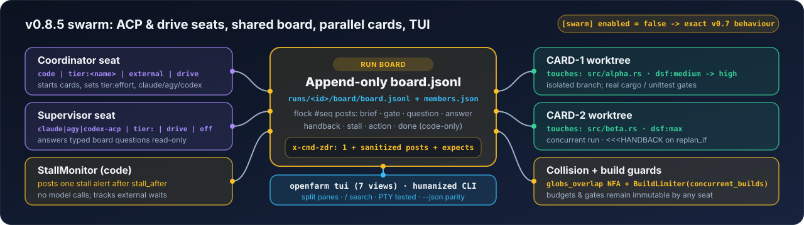
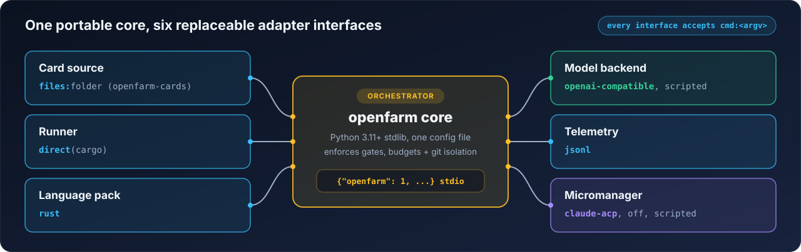

<p align="center">
  
</p>

<h3 align="center">Spend frontier tokens on thinking, not on compile errors.</h3>

<p align="center">
  openfarm gives your best model the work that needs judgement: the architecture, the card design and the final review.<br>
  A cheaper model takes the grind: writing the tests, writing the code, and retrying against the compiler and the tests within fixed budgets.<br>
  The gates are run by plain code, the grind never touches your frontier context, and every card comes back as a reviewable branch or an honest "blocked".
</p>

<p align="center">
  
  
  
  
  
  
</p>

<p align="center">
  <a href="#quickstart"><b>Quickstart</b></a> &nbsp;&bull;&nbsp;
  <a href="#what-changed-in-v081"><b>What changed in v0.8.1</b></a> &nbsp;&bull;&nbsp;
  <a href="#how-it-works"><b>How it works</b></a> &nbsp;&bull;&nbsp;
  <a href="#commands"><b>Commands</b></a> &nbsp;&bull;&nbsp;
  <a href="#whats-verified"><b>What's verified</b></a> &nbsp;&bull;&nbsp;
  <a href="#roadmap"><b>Roadmap</b></a> &nbsp;&bull;&nbsp;
  <a href="docs/openfarm-internals.md"><b>Internals &amp; spec</b></a>
</p>

<p align="center">
  
</p>

> [!IMPORTANT]
> **Pre-release (v0.8.1).** v0.8.1 adds Codex and Antigravity as frontier providers next to Claude, `openfarm drive` to hold the coordinator and supervisor seats with a CLI agent, and a TypeScript pack. After the first build, two reviews and live runs with the real tools found gaps, and the fix work closed them: Codex and Antigravity children now run inside a bubblewrap boundary, the checker's counter-tests are read and run, and ruff, pytest, cargo-mutants, tsc and prettier are called the way the real programs need. The offline suite has 1321 tests with no failures. What ran live on 17 Nov 2026, and what has not run at all, is in [What's verified](#whats-verified) and [Not yet tested](#not-yet-tested). With `[swarm] enabled = false` a run behaves as in v0.7.

---

## Why openfarm

Frontier models are brilliant at architecture and review, and wasteful when you leave them grinding through compile, fix, retry. Every failed build they read is context they carry forward, and a long session full of stale attempts makes their later work worse (context rot). openfarm moves the grind somewhere cheaper and keeps the frontier conversation clean.

<table>
  <tr>
    <td width="33%" valign="top">
      <h3>Think once</h3>
      Your frontier model writes a protected invariants file, one clean golden reference slice and a queue of small, precisely specified cards. Then it steps back until there is something worth reviewing. The design target is roughly 3k to 8k frontier tokens for all of that, review included.
    </td>
    <td width="33%" valign="top">
      <h3>Grind out of sight</h3>
      A non-frontier model works each card, and the farm is built to run unattended, overnight if you like. Compiler loops, retries, revert checks and counter-tests all happen inside openfarm, against fixed budgets, and none of that noise ever reaches your frontier context.
    </td>
    <td width="33%" valign="top">
      <h3>Trust code, not claims</h3>
      No model reports its own result. The orchestrator runs every gate itself, worker models get no shell and no tools, and edits only land inside the files a card allows. You review a compact dossier and a diff, not a transcript.
    </td>
  </tr>
</table>

The bar openfarm sets itself is economic, not just "cheap tokens": a merged card should cost less in total, **including the frontier's time to specify and review it**, than having a frontier subagent write it. That is the hypothesis the [planned pilot](#roadmap) will test.

## Quickstart

openfarm is installed and driven through your frontier coding agent (Claude Code, Codex, Antigravity, or any agent that reads `.agents/skills`). Two sentences take you from an empty folder to a checked queue of cards.

<p align="center">
   1. Install (Read and install this skill) -> 2. Initialize (/openfarm-initialize or openfarm adopt) -> Checked queue (invariants, golden slice and baseline-checked cards) -> Swarm + TUI (parallel gated branches, inspect in openfarm tui or drive, merge locally)." width="100%">
</p>

### 1. Install

Ask your agent:

```text
Read and install this skill https://github.com/grandprixgp/openfarm
```

The agent reads the root [`SKILL.md`](SKILL.md) and installs openfarm with a package installer (`uv tool install`, `pipx install` or `pip install --user`), or straight from a clone with no `pip` at all:

```bash
git clone https://github.com/grandprixgp/openfarm
cd openfarm
python3 -m openfarm_core.cli install-skill --target all --install-bin ~/.local/bin --json
```

This deploys `/openfarm-grill-me`, `/openfarm-initialize` and `openfarm` for Claude Code (`$CLAUDE_CONFIG_DIR`, default `~/.claude`), Antigravity (`~/.gemini/config`), Codex (`$CODEX_HOME/skills` and `$CODEX_HOME/openfarm-AGENTS.md`, default `~/.codex`), and `.agents` / workspace folders (`--target claude|antigravity|codex|agents|workspace|all`), plus an optional `openfarm` launcher on your `PATH`. Whether Codex picks up the files under `$CODEX_HOME` by itself is untested.

Then check the frontier provider you want to supervise with (see [Providers](#providers-claude-codex-and-antigravity) before choosing one):

```bash
openfarm acp status --json                 # all three providers; never starts agy
openfarm acp login --provider claude       # or --provider codex | antigravity
openfarm acp probe --provider claude --json
```

`openfarm acp probe --provider all` probes Claude and Codex and skips Antigravity, because probing Antigravity starts `agy`; name it (`--provider antigravity`) to probe it. A probe says `ok` only when every provider it probed is ok, and exits `3` otherwise.

### 2. Grill (Optional) & Initialize

In an empty folder, ask your agent:

```text
/openfarm-initialize calorie-log An app to track my calories
```

By default `/openfarm-initialize` starts with `/openfarm-grill-me` (one frontier question at a time, with a recommended answer) to lock down invariants, golden slice boundaries, and the frontier and worker setup before touching code (pass `--no-grill` or run `/openfarm-grill-me` separately beforehand).

| Stage | Lane | What happens |
| --- | --- | --- |
| **Grill** | You + Frontier | One-question-at-a-time decision tree settles invariants, public crate surface, dependencies, and exact `Done` boundaries into `.openfarm/GRILL_DECISIONS.md` |
| **Scaffold** | Code | `openfarm init` writes a validated `.openfarm/config.toml` (frontier supervisor over OAuth by default, `--acp-provider claude\|codex\|antigravity`; workers on an API key), protected `src/invariants.rs`, starter Rust files, `Cargo.lock` and git, putting state outside the repo with `0700` permissions |
| **Architect** | Frontier | Expands the invariants, exports clean `pub` types and builds one complete, green golden slice that passes `cargo test`, `clippy -D warnings` and `rustfmt --check` |
| **Decompose** | Frontier | Writes dependency-ordered Wave 1 to 3 cards under `cards/`, commits them on `main`, and checks every one with `openfarm check` and `openfarm run --dry-run` |
| **Run** | Farm | `openfarm supervise --prepare-queue --apply` then `openfarm run --cards N` work the queue out of frontier context |
| **Review** | You | Read each dossier and `git diff main..<branch>`, record `openfarm verdict`, and merge locally with `git merge --no-ff`. openfarm never merges or pushes |

The full walkthrough of this example is in [`docs/FROM-IDEA-TO-SHIPPED-APP.md`](docs/FROM-IDEA-TO-SHIPPED-APP.md).

> [!NOTE]
> **Requirements:** Python 3.11+ and git. The Rust pack also needs `cargo`, `clippy` and `rustfmt`, and its mutation gate needs `cargo-mutants`. The TypeScript pack needs `node` (tests run with `node --test`). The Codex and Antigravity providers need bubblewrap (`bwrap`) under the default `[micromanager] confine = "auto"`, except Codex with tool policy `none` through openfarm's own bridge, which runs on its tool flags when `bwrap` is missing and says so in the run's notes. Workers authenticate with an API key against an OpenAI-compatible endpoint on `allowed_endpoints`; the frontier supervisor uses the provider's own login.

## Existing projects, Python and TypeScript

For a repository that already exists, adopt it first:

```bash
openfarm adopt --dir .
```

Adopt writes `.openfarm/config.toml`, `.openfarm/PROJECT_SPEC.md` and `cards/.gitkeep` and commits nothing. Commit them, and your cards, before `openfarm check` or `openfarm run`: openfarm reads cards from the committed base branch.

Adopt also runs your suite once (`--no-suite` skips it). A suite that does not build is refused before anything is written. Tests that fail are listed in a comment above `[policy] known_failing`; openfarm refuses a red base, so copy them in only if you want to work with them failing.

A `Cargo.toml` or a Python manifest decides the language. If a `package.json` or `tsconfig.json` sits beside it, adopt notes it and uses Rust or Python; pass `--lang typescript` to adopt the TypeScript side instead. One checkout holds one config, so it is one language per adoption.

Then batch-grill the project:

```text
/openfarm-grill-me --batch
```

Check the first card:

```bash
openfarm check CARD-001
```

`openfarm check` also shows the tooling the card's gates will use (test runner, type check or lint, formatter) and the language pack's notes.

- **Python** repositories use `unittest` unless they configure pytest (`pytest.ini` or `[tool.pytest.ini_options]`). `ruff` runs (lint and format) only when the project configures it (`[tool.ruff]` in `pyproject.toml`, `ruff.toml` or `.ruff.toml`) and it is installed. Otherwise lint is a syntax check, formatting is not checked, and the run's notes say which case applies.
- **TypeScript** tests run only with `node --test`. A test script that uses npm, jest, vitest or mocha is refused at adopt and at check. `tsc --noEmit` runs when the project has `tsc` and a `tsconfig.json`; otherwise the type check is a syntax check by node's own type stripping, no types are checked, and the notes and gate records say "syntax only". `prettier` runs only when the project configures it. Adopt records these choices under `[runner]`, and check and every card use the same ones. Card worktrees link the base checkout's git-ignored `node_modules`. There is no mutation tool for TypeScript.

## What changed in v0.8.1

For a reader upgrading from v0.8. Details are in [`docs/USAGE-AND-FIRST-DEPLOYMENT.md`](docs/USAGE-AND-FIRST-DEPLOYMENT.md).

- **New providers.** `[adapters] micromanager`, `model` and the swarm seats accept `codex-acp` and `antigravity-acp` (or `agy-acp`) next to `claude-acp`. `openfarm init --acp-provider` and `openfarm acp --provider` pick one.
- **New subcommand.** `openfarm drive` holds the external seats with a `claude`, `codex` or `agy` CLI. There are now 22 subcommands.
- **New language.** `openfarm adopt --lang typescript` (see above).
- **New config keys.** `[micromanager] confine` (`"auto"`, `"bwrap"` or `"off"`, default `"auto"`) and `confine_read_roots`. `[runner] typescript` (only `"node"`), `typescript_typecheck`, `typescript_format` and `link_node_modules`. `[micromanager] effort` also takes `"xhigh"` and `"max"`.
- **New refusals.** A Codex or Antigravity child that needs the boundary is refused when `bwrap` cannot run. Codex with tool policy `read-only` is refused where Codex's own sandbox cannot start inside the boundary, as on Ubuntu with its default AppArmor rule. A `binary` that names another provider than its adapter is refused (`acp-provider-mismatch`). An Antigravity prompt over 131072 bytes is refused before `agy` starts (`agy-prompt-too-large`). `[gates] mutation = "required"` is a config error when TypeScript is in `languages`.
- **Changed behaviour for Python.** v0.8 used `ruff` whenever it was installed; v0.8.1 uses it only where the project configures it.
- **Changed behaviour for every language.** A named test must fail on base in every row and pass after in every row; a parametrized test's rows count as the test's. A test run the runner classes as infra (timed out, killed) is never green. `check --baseline` refuses a named test that is skipped or expected to fail on base (`ignored_on_base`).
- **The checker.** Both checker passes answer in a fixed form and are asked once more when the answer cannot be read. Counter-tests are written as new files, run one at a time, and removed, and the worktree is put back exactly.
- **The test writer.** For a Rust integration test the brief names the library crate and says to import through it, never with `#[path]`. When the named tests cannot be listed because the test build failed, the message carries the compiler's errors.
- **Logins.** openfarm finds the Claude and Codex logins through `CLAUDE_CONFIG_DIR` and `CODEX_HOME` first, then `$HOME`. A refreshed login is copied back only when it has the provider's shape for the same account; the old one is kept as `<name>.openfarm-backup`. `install-skill` writes to those folders too.
- **ACP workers and the ACP coordinator** run in an empty private folder, not the state folder.
- **Spend.** Codex and Antigravity report no cost, so without per-1k rates their spend reads zero and a spend cap cannot fire on it. As workers (`[adapters] model`), set `[model] cost_per_1k_in` / `cost_per_1k_out`; without them `run.json` says `spend_measured: false` and the run's notes say the caps cannot fire. As the micromanager, set `[micromanager] cost_per_1k_in` / `cost_per_1k_out`; without them the run's notes say its spend caps cannot fire.
- **`openfarm acp`.** `acp status` with no `--provider` covers all three providers and runs `codex login status` as well as `claude auth status`; it never starts `agy`. `acp probe --provider all` skips Antigravity and exits `3` unless every probed provider is ok.
- **`run.lock`** records the pid, host and start time. A lock whose holder on this host is no longer running is taken over, with a note.
- **Bench.** `--tasks` and `--out` may be relative paths, and a run that never started is listed as an error with its reason instead of counting as a failed task.

## Providers: Claude, Codex and Antigravity

The frontier supervisor (the micromanager), the solo bench arm's workers and the swarm seats can run on any of three providers. Each provider's child runs with an isolated home (`isolate_home = true`, the default), a cleaned environment, and the provider's login copied in. What the child can read depends on the provider, its tool policy (`[micromanager] tool_policy`) and `[micromanager] confine`:

| Provider | `confine = "auto"` (default) | Recommended |
| --- | --- | --- |
| **Claude** (`claude-acp`) | No OS boundary. Claude Code's own settings hold it: tool policy `none` gives it no tools; `read-only` gives `Read`, `Glob` and `Grep` with a deny list built from `never_touch` and `forbidden_files` | Tool policy `none` |
| **Codex** (`codex-acp`) | Through openfarm's bridge with tool policy `none`: Codex's tools turned off by flags (no shell, no web search), plus the boundary when `bwrap` works. Everything else needs the boundary and is refused without it | `binary = "codex-exec"`, tool policy `none` |
| **Antigravity** (`antigravity-acp`) | Always inside the boundary, refused without it. agy has no documented no-tools flag, so tool policy `none` is agy's own `--sandbox` plus the boundary | See below |

The boundary is a bubblewrap sandbox. It shows the child the system folders, the program's own install folder, any `confine_read_roots`, its isolated home (read-write), a private `/tmp`, and the session folder read-only with every `.git`, the `never_touch` and `forbidden_files` matches and the worker key file hidden. It does not show your real home, the state folder or other cards' worktrees. It shares the network, because the model call needs it.

`confine = "bwrap"` puts every provider in the boundary, Claude too, and refuses when `bwrap` cannot run. `confine = "off"` puts nothing in a boundary: the child can read whatever your user can, and the run's notes say so.

- **Codex:** use openfarm's bridge, `[micromanager] binary = "codex-exec"`. `binary = "auto"` picks the same bridge whenever the `codex` CLI is installed. A standalone `codex-acp` server runs only when you name it (`binary = "codex-acp"`) or when it is the only Codex program on `PATH`; version 0.16.0 completed no turn on a ChatGPT login in testing.
- **Antigravity:** openfarm starts `agy` with no person typing. Before you use it on your Antigravity OAuth login, check that your Antigravity plan's terms allow that. The other route is an API key: `auth = "api-key"` with `auth_file` passes the key to `agy` as `GEMINI_API_KEY` (untested live). Every Antigravity change since the first build is untested live.
- **Claude:** the standalone `claude-agent-acp` server is the npm package `@agentclientprotocol/claude-agent-acp` (the older `@zed-industries/claude-agent-acp` name is an old version). Without it on `PATH`, `binary = "auto"` uses openfarm's bridge over `claude -p`.

`openfarm acp status` and `openfarm acp probe` show, per provider and tool policy, how its child would be held (`flags + boundary`, `boundary`, `flags`, `nothing` or `refused`), where its login was found, and whether `bwrap` works.

## Driving the seats with `openfarm drive`

With `[swarm] enabled = true`, the coordinator and supervisor seats can be held from outside openfarm. `openfarm drive` holds them with a `claude`, `codex` or `agy` CLI run headless:

```bash
openfarm drive --agent codex --seat both --cards 1 --wave --json
```

- Without `--run ID` it starts a managed run and drives it; with `--run ID` it attaches to a run another process owns.
- Each turn's prompt carries what the driver needs: the board state, and with `--wave` the card's dossier and diff. The driver's Claude child has no tools. Its Codex and Antigravity children are held as in [Providers](#providers-claude-codex-and-antigravity), in an empty private folder.
- A question the driver cannot answer, or a turn that fails, goes the way `[swarm] on_external_timeout` says (`block` gives `seat-silent`; `fallback` hands it to code). The driver never makes up an approval.
- Each turn runs in its own process group and is ended after `--turn-timeout` seconds (default 180).
- A managed drive's spend counts against `--spend` and `spend_per_night` with the run's. An attached drive's spend does not count against the other process's caps, and it says so.
- `--wave` adds the driver's own look at each `in-review` card. `--record-verdict` writes it as `by: driver/<agent>`, only where no verdict exists yet, never `clean` on a cut diff, and nothing when the driver gave no usable answer. It is a cheap model's opinion, not your review: `openfarm verdict` overwrites it.
- A drive that ended can be started again on the same run under the same `--driver-name`; it takes its seat back if nobody else holds it.

## Global learning

- Every project learns lessons from its own cards, as before. Each lesson is marked `project` or `general`. Claude claims one, and plain code keeps it `project` if it names one of the project's files, functions, cards or its name.
- A general lesson that has helped on 3 or more cards, with fewer hurts than helps, goes to a global library at `~/.openfarm/global/harness`, unless the project sets `share = false`. `[harness] global_dir` moves the library. Notes about openfarm's own bookkeeping, fixed-rule hints, long lessons and lessons with code never go.
- Other projects import a global lesson as a new lesson of their own and try it like one. A project that finds it hurts switches it off for itself. Two such projects, or a negative combined score, retire it everywhere.
- `[harness] learn_from = "both" | "project" | "global"` picks which lessons apply. The default is `both`, and `openfarm run --learn-from ...` overrides it for one run.
- `openfarm harness status --global` lists the global lessons and their source projects. `openfarm harness demote <id> --global` retires one, and `openfarm harness promote <id> --global` brings it back.
- Bench runs use a throwaway global library of their own, so they never read or change yours.
- Sharing lessons across a live two-project exchange ran on 17 Nov 2026 (`proj-alpha` promoted `g-52723ab8fa` via `harness promote --global`, and `proj-beta` imported and applied it in a live `tier:dsf` run to pass hidden tests); multi-card organic accumulation across two long-lived external repositories remains **untested**.

## Efficacy bench

`openfarm bench` measures whether the farm pays off, with your own models. It ships 12 tasks in `bench/` (6 Rust, 6 Python, across small features, pinned bug fixes, patterns and refactors), each with a starting project, a card, and hidden tests that the models never see.

```bash
openfarm bench list
openfarm bench run --dry-run                      # scripted answers, costs nothing
openfarm bench run --arm farm=farm.toml --arm solo=solo.toml
```

Each run starts from a fresh copy of the task's project and runs its card. Then it copies the hidden tests onto the result and runs the whole suite. There are two arms:

- **farm**: your worker model, with a frontier supervisor if you like.
- **solo**: the frontier model doing every worker role itself, through the same briefs and gates.

An arm file sets only the model and supervisor tables; copy one from [`bench/arms/`](bench/arms/) (Claude, Codex and Antigravity examples; for Codex, set `binary = "codex-exec"` in the copy). Each task runs 3 times per arm by default. The report (`bench-report.md` and `.json`) gives pass rate, tokens, tokens per pass, the worker's share of those tokens and per-category pass rates for each arm, lists any run that did not start with its reason, and stays on your machine. The workers and the supervisor still see each card and starting project, as in any run. Results so far are in [`docs/bench-v0.8.1.md`](docs/bench-v0.8.1.md).

## Swarm, board, parallel cards, and TUI (v0.8)

<p align="center">
  , external), Supervisor seat (config, tier:<name>, external, off), and code StallMonitor connected to an append-only file-locked board.jsonl while non-colliding cards run in parallel worktrees bounded by globs_overlap and BuildLimiter and inspected live via the 7-view stdlib TUI and humanized CLI." width="100%">
</p>

Enable `[swarm]` (`enabled = true` in `.openfarm/config.toml`; off by default so v0.7 queues behave identically) to run cards through a shared message board:

- **Tiers & effort (`[tiers.<name>]`, `RoleModel.effort`)**: Define model tiers and effort ladders (`off`..`max`) injected cleanly via `effort_param` (`reasoning_effort` by default) on OpenAI-compatible payloads, while keeping `[model]` endpoint allowlists and `headers` (e.g. `x-cmd-zdr: 1`) invariant across every call.
- **Shared board & checked actions (`openfarm board`, `openfarm swarm`)**: Every claim, brief, worker result, gate check, hand-back (`<<<HANDBACK ... >>>` when `replan_if` fires), and `answer` (validated against structured `expects`) lands on `<state_dir>/runs/<run_id>/board/`. Non-code members can never post `done`/`gate` or bypass deterministic gates.
- **Coordinators & seats**: Plug in `"code"` (default deterministic escalation), `"tier:<name>"` (model coordinator with call/token caps and 2-bad-answer fallback), or `"external"` (`openfarm swarm join|start|set|hint|block|remove`, or `openfarm drive`, timed by `external_wait` -> `fallback` or `seat-silent`) for `[swarm] coordinator` and `supervisor` (`config`, `external`, `off`, or `tier:<name>`).
- **Parallel non-colliding cards & `StallMonitor`**: Exact glob overlap (`globs_overlap`) + dependency/ID checks schedule independent cards concurrently (`concurrent_cards`, bounded by `[budget] concurrent_builds`), while `StallMonitor` (`role = "monitor"`, `stall_after`) posts a single `stall` alert when all active members pause on an unanswered question.
- **Pure-stdlib TUI (`openfarm tui`) & human CLI**: Inspect 7 views (`overview`, `cards`, `dossier`, `board`, `swarm`, `harness`, `ops`) in a responsive split-pane `curses` UI (`NO_COLOR` fallback, `/` live search, centered modals, real-PTY tested) or one-shot `--once` / `--json` snapshots, view evidence safely confined inside `state_dir`, and run CLI commands with aligned TTY/`NO_COLOR` tables, token bars, forgiving bare `board`/`swarm`/`bench`, and contextual hints (`--json` parity preserved). Live smoke instructions and 17 Nov 2026 results are in [`docs/v0.8-smoke.md`](docs/v0.8-smoke.md).

## How it works

<p align="center">
  
</p>

| Lane | Who | Does | Never does |
| --- | --- | --- | --- |
| **Frontier** | Your frontier agent, or you | Architecture, seam contract, golden slice, card decomposition, review, verdict, merge | The compile and retry grind |
| **Orchestrator** | Plain Python | Claims cards, builds every brief, applies edits, runs every gate, enforces budgets, writes dossiers and telemetry | Merge, rebase or push (the core has no code path that runs `git push`) |
| **Farm** | Non-frontier models in four stateless roles | Splits a card into steps, writes the named tests, writes the code, tries to break it with counter-tests | Run commands, touch files outside the card, see never-touch files, report a gate result |

The **micromanager** is the built-in frontier supervisor (`openfarm init` sets it to Claude over OAuth with `binary = "auto"` and `mode = "active"`; `--acp-provider` picks Codex or Antigravity; opt out with `--profile solo` or `mode = "off"`). It can shape cards, scaffold contracts, coach a stalled card, adjudicate counter-tests and pre-review under its own separate budget, and never certifies a gate. openfarm grants it no write or terminal capability over ACP; what the provider's own child can read is set out in [Providers](#providers-claude-codex-and-antigravity). Workers are configured separately, with `[model] key_file`.

### Every card, every time

<p align="center">
  
</p>

<details>
<summary><b>The eight steps in detail</b></summary>

1. **Claim and eligibility:** the card is hashed and checked against every eligibility rule before any model call. An ineligible card is released, not blocked.
2. **Isolate:** one branch, one worktree and one build target per card.
3. **Baseline green:** the suite runs twice on the base; a red test or a disagreement stops the card.
4. **Shape and plan:** an optional planner or micromanager splits the card into checkpointed steps.
5. **Phase A, tests:** the test writer writes the named tests. They must compile and *fail* on the base, in every row (a parametrized test's cases included), then they are frozen by hash.
6. **Phase B, code:** the implementer edits only the files the card lists. Every attempt runs the diff, banned-pattern, frozen-test, suite and lint gates; on failure it gets only the diff and the exact failure output.
7. **End gates:** pass-after twice, full suite, format and workspace lint, no test loss, revert check, mutation (report-only by default), two checker passes, optional pre-review.
8. **Catch-up and capture:** a throwaway trial merge with the current base, then lessons from the outcome are recorded for the next card.

</details>

The checker's first pass restates the card's Done text in its own words (`RESTATEMENT:`), says whether the tests would catch a bad implementation (`CATCHES:`) and what they miss (`MISSES:`). Only the restatement is compared with the tests; the rest goes into the dossier and blocks nothing. Its second pass gives a verdict, reasons, a traceability table, edge cases, and up to two counter-tests, each a complete test file under `=== counter_test: <name>`. Each counter-test is run alone against the diff. With `[gates] counter_tests = "report"` (the default) a failing one is reported; with `"reject"` the card goes back to the implementer once, unless the micromanager dismisses it as a false reject, and blocks with `checker-reject` if it still fails. An answer that cannot be read is asked for once more. The verdict alone never blocks a card.

The Rust mutation gate runs `cargo-mutants` with its output outside the worktree and reads `outcomes.json`; the kill rate is caught over caught plus missed, with timed-out and unviable mutants reported apart.

### What makes a good card

Cards declare a category, and each repository enables the ones it trusts:

`test-backfill` &nbsp; `pattern` &nbsp; `pinned-bugfix` &nbsp; `mechanical` &nbsp; `small-feature` &nbsp; `feature` &nbsp; `refactor` &nbsp; `integration` &nbsp; `port`

A card must name every test and what it asserts with concrete inputs and outputs, stay within one unit and a handful of files, and leave no design decisions. Words like "handle", "properly" or "robust" without named cases are rejected. Concurrency primitives, `unsafe`, cross-crate public APIs and anything on the `never_touch` list are never eligible.

### A farm that learns, safely

openfarm keeps a small, bounded memory of what helped weaker models recover from failures, inspired by Harness² ([Xu et al., 2026, arXiv:2610.14224](https://arxiv.org/abs/2610.14224)). After each judged card it extracts short cues, such as a recovery pattern for a borrow-checker error, and feeds them into later briefs in the same run and in later runs.

> [!TIP]
> New cues go through a **propose, probe, confirm** loop: they are tried over a window of cards and rolled back automatically if pass rate or efficiency regresses. Cues can only change five guidance surfaces. Every gate, budget and policy list is immutable, and any cue that tries to bypass a gate, leak test values or escape a path is rejected. Outages and operator stops are kept out of the metrics. Manage it all with `openfarm harness`.

## Architecture

The core reads one config file per repository and talks to the outside world only through six adapter interfaces. Each has built-in implementations, and any of them can be swapped for an external command that speaks a small JSON protocol (`{"openfarm": 1, ...}`) over stdin and stdout.

<p align="center">
  , external, off). Every interface also accepts cmd:<argv> over stdio JSON." width="100%">
</p>

Every adapter also accepts `cmd:<argv>`. Card state lives on its own `openfarm-cards` branch so parallel cards never conflict. TypeScript projects run on `node --test`, with `tsc` when the project has it and a `tsconfig.json`, and `prettier` when the project configures it. Git is the one hard dependency, and nothing in the core names a particular project.

### Safety boundaries

| Boundary | How it holds |
| --- | --- |
| **Never-touch paths** | File globs, with symlinks resolved, checked on the card at eligibility and on the diff at every attempt. Never loaded into any brief, not even as signatures |
| **No push** | The core has no code path that runs `git push`, and its git wrapper blocks dangerous global flags and config overrides |
| **Untrusted text is fenced** | Card text, diffs, test output and repository files are wrapped as data in every brief, with terminal control sequences stripped |
| **Endpoint allowlist** | The model backend refuses any endpoint or redirect not on `allowed_endpoints`, and reads its key from a file outside the repo that is never logged |
| **Provider children** | Isolated home and cleaned environment for every provider; Codex and Antigravity inside a bubblewrap boundary under the default `confine = "auto"` (see [Providers](#providers-claude-codex-and-antigravity)). The boundary shares the network |
| **State stays out of the repo** | Prompts contain repository text, so the state folder lives outside the repo and should stay out of unencrypted synced folders |
| **Config is farm-proof** | `.openfarm/**` and `.claude/**` are always forbidden to the farm (and `.gemini/**`, `.codex/**`, `.agents/**` to provider children), and unknown config tables or keys are rejected so a typo can never silently disable a gate |
| **Tests run as you** | The runner has no sandbox: a test, or the code it runs, can do what your user can. In a TypeScript card that includes writing through the linked `node_modules` into the base checkout |

## Commands

One `openfarm` command with 22 subcommands (`6` pre-config helpers + `16` repository commands), shared exit codes (`0` done, `1` refused or ineligible, `2` usage or config error, `3` trouble or infra) and `--json` output.

| Command | Purpose |
| --- | --- |
| `openfarm init NAME` | Scaffold a new Rust repo with validated config (`--acp-provider claude\|antigravity\|codex`, OAuth by default; workers on an API key), protected invariants, starter files, `Cargo.lock` and git |
| `openfarm adopt` | Adopt an existing Rust, Python, or TypeScript repository with baseline verification (`--lang rust\|python\|typescript`) |
| `openfarm bench` | List or run the 12 efficacy bench tasks (`list`, `run --dry-run` or live arms across [`bench/arms/`](bench/arms/)) |
| `openfarm install-skill` | Deploy the bundled skills (`/openfarm-grill-me`, `/openfarm-initialize`, `openfarm`), slash commands, Antigravity plugin, Codex skills/AGENTS, and optional launcher (`--target claude\|antigravity\|codex\|agents\|workspace\|all`) |
| `openfarm acp [ACTION]` | Check frontier logins and how each provider's child is held (`status`), log in (`login`), update `.openfarm/config.toml` (`configure`), or run a zero-token ACP handshake (`probe`), with `--provider claude\|antigravity\|codex\|all` |
| `openfarm tui` | Launch the 7-view split-pane stdlib TUI (`--run`, `--refresh`, `--once`, `--view`, `--json`; `NO_COLOR`, `/` search, works pre-config too) |
| `openfarm run` | Work Ready cards, bounded by `--cards`, `--spend`, `--for` or `--until`; `--dry-run` checks without model calls |
| `openfarm status` | Show farm, card and harness-memory status |
| `openfarm pause` / `resume` / `stop` | Operator controls, including clearing the circuit breaker or kill switch |
| `openfarm release CARD` / `done CARD` | Release a card back to the queue, or mark a locally merged card done |
| `openfarm dossier CARD` | Print a card's reviewer dossier as Markdown or JSON |
| `openfarm check CARD` | Check a card's eligibility and show the tooling its gates will use, and optionally its baseline (`--baseline`) |
| `openfarm verdict CARD` | Record the review outcome (`clean`, `minor-fix`, `bounced`, `scrapped`) and its cost; overwrites a `by: driver/<agent>` verdict |
| `openfarm escape CARD` | Record a defect that got past review |
| `openfarm supervise` | Run bounded micromanager triage of blocked cards or queue preparation |
| `openfarm harness` | Inspect or manage harness memory (`status`, `index`, `show`, `promote`, `demote`, `reset --yes`, `--global`) |
| `openfarm board` | Inspect or interact with a live run's board (`read`, `post`, `answer`, `wait`) |
| `openfarm swarm` | Inspect tiers/roster or act as external coordinator (`status`, `tiers`, `join`, `start`, `set`, `hint`, `block`, `remove`) |
| `openfarm drive` | Hold the external `coordinator`/`supervisor` seats with a `claude`, `codex` or `agy` CLI (`--agent`, `--seat`, `--run`, `--turn-timeout`, `--wave`, `--record-verdict`); see [Driving the seats](#driving-the-seats-with-openfarm-drive) |

## Configuration

Each repository carries `.openfarm/config.toml` on its base branch, and `openfarm init` / `openfarm adopt` writes a validated one for you.

<details>
<summary><b>The 15 config tables, budgets and hooks</b></summary>

<br>

**Tables:** `[project]`, `[adapters]`, `[model]`, `[policy]`, `[eligibility]`, `[brief]`, `[runner]`, `[budget]`, `[gates]`, `[cards]`, `[micromanager]`, `[state]`, `[harness]`, `[tiers.*]` and `[swarm]`.

**Budgets** are absolute and enforced in code: implementer and test-writer attempts, model-driven builds, mutation builds, tokens and wall clock per card, spend per night, per-run coordinator call/token caps, concurrent builds/cards limits, plus a kill switch and a circuit breaker. The micromanager has its own separate budget, so supervision spend stays visible in the payback numbers. A spend cap can only fire on spend that is measured: Claude reports its cost, Codex and Antigravity do not, so for them set `cost_per_1k_in` / `cost_per_1k_out` in the table they answer for (`[model]` as workers, `[micromanager]` as supervisor).

**Three hooks** keep a repository's quirks out of the core: `[[gates.extra]]` for named commands that must pass, `[runner.env]` for per-unit environment variables, and `[brief] test_conventions` for a test-writing guide.

**Provider confinement:** `[micromanager] confine` (`"auto"`, `"bwrap"`, `"off"`) and `confine_read_roots` (extra absolute folders shown read-only inside the boundary). **TypeScript tooling:** `[runner] typescript`, `typescript_typecheck` (`"auto"`, `"tsc"`, `"syntax"`), `typescript_format` (`"auto"`, `"prettier"`, `"off"`) and `link_node_modules`.

Every key, gate, stop code (`19` per-card stop codes including `handed-back` and `seat-silent`) and record format is documented in [`docs/openfarm-internals.md`](docs/openfarm-internals.md) (and the owner's local spec `openfarm spec v0.8.md` when present).

</details>

## What's verified

### The offline suite

On the final v0.8.1 tree, Python 3.14 on Linux:

| Run | Result |
| --- | --- |
| Default, no optional tools on `PATH` | **1321 tests**, 88 skipped, **0 failures** |
| `OPENFARM_E2E=1` with ruff 0.17.5, tsc 7.0.2, prettier 3.10.1 and cargo-mutants 27.1.0 on `PATH` | **1321 tests**, 15 skipped, **0 failures** |

A test that needs a real tool skips itself when the tool is missing, so the default run's skip count depends on what you have installed. Of the 15 skipped in the second run, 12 need a Python that can import pytest and pass when run under one (pytest 9.2.0); the others are stand-in tests that step aside when the real tool is there. Each test process keeps its temp files in one folder of its own and removes it at exit.

The suite includes, among the rest:

- an offline wheel build, with all 12 bundled skill asset files present and all 8 `skills/` files byte-identical;
- `install-skill` (deploying `openfarm-grill-me`, `openfarm-initialize`, `openfarm`, slash commands and plugin) and its launcher shim executing;
- `openfarm init` defaults (`profile = active`, `micromanager = claude-acp`, `auth = oauth`, `binary = auto`), `Cargo.lock`, containment and permissions;
- the three providers' bridges over stdio pipes with stand-in CLIs, login isolation and the checked copy-back of a refreshed login, and the bubblewrap boundary with a real `bwrap` (a stand-in child cannot read a file outside its session folder, the real home, a hidden `never_touch` file or the worker key file); these tests skip where `bwrap` cannot run;
- the scaffolded project passing `cargo test --locked`, `cargo clippy --locked --all-targets -- -D warnings` and `rustfmt --edition 2021 --check`;
- a card that touches a never-touch path being rejected, and scripted cards running all the way to `in-review` in Rust, Python and TypeScript;
- real ruff, pytest, cargo-mutants, tsc and prettier through the packs' own commands, where installed;
- counter-tests written, run and removed with the worktree restored exactly, in Python, Rust and TypeScript (with real `node`);
- `openfarm drive` with scripted and stand-in drivers: abort, turn timeout, seat time-outs, spend, rejoin;
- `openfarm adopt` on Python, Rust and TypeScript repositories, including a red suite proposed in a comment and a crate that does not build refused before anything is written;
- every one of the 12 bench tasks: its scripted answer passes its hidden tests through a real `openfarm run`, and its untouched starting project fails them;
- parallel non-colliding Rust `cargo` card execution, the PTY-tested `curses` TUI, and human CLI formatting with `--json` parity.

Model calls in these tests use a scripted backend and local HTTP test servers, and the provider tests use stand-in CLIs. No test calls a real model.

### Tested live in the v0.8.1 fix work (17 Nov 2026)

Numbers and trees are in [`docs/v0.8.1-build-log.md`](docs/v0.8.1-build-log.md) and [`docs/bench-v0.8.1.md`](docs/bench-v0.8.1.md). Where workers or a live checker ran, they were DeepSeek V4.1 Flash on Command Code with `x-cmd-zdr: 1`.

- **Real ruff, pytest, cargo-mutants, tsc and prettier** run by the suite and by hand; the code that calls them was fixed against the real programs.
- **The checker with a live model** on the final code (24 runs over the 12 bench tasks, each with a planted bug and clean): both passes readable on the first ask in 24 of 24; 12 of 12 planted bugs caught by a failing counter-test; on the clean cards 2 alarms, both real gaps in the bench's own reference solutions; 0 wrong counter-tests.
- **Codex** (codex-cli 0.166.0) through openfarm's bridge inside the boundary: tool policy `none` read none of three planted files; `read-only` cannot work inside the boundary on Ubuntu and is refused up front; `off` read all three. One bench card passed hidden tests with Codex supervising this way.
- **A standalone `codex-acp` server** (0.16.0): handshake, new session and option setting work inside the boundary; no turn completed on a ChatGPT login.
- **Claude** (Haiku 5.5 and Opus 5.5) through openfarm's bridge and through the standalone `claude-agent-acp`, tool policy `none` and `read-only`: all answered, with the login found through `CLAUDE_CONFIG_DIR`.
- **`openfarm drive`** with real Codex (inside the boundary) and real Claude: each took one card to `in-review` with hidden tests passing, and recorded a wave verdict.

The first build's live runs (before the fix work) are kept, with what has changed since, in the build log.

## Not yet tested

> [!WARNING]
> - Everything Antigravity since the first agent's runs: the boundary around `agy`, the login copy, the prompt-size refusal, the driver. Nobody may run `agy` unattended here.
> - A turn through a standalone `codex-acp` server, and so per-card confined servers with it.
> - Codex `read-only` inside the boundary on a system that allows a nested sandbox.
> - In `drive` with a real CLI: Ctrl-C, taking over a stale lock, a turn timeout, a spend cap stopping a priced driver.
> - TypeScript on a real npm-installed project with a live model writing counter-tests (the TypeScript counter-test path ran with real node and scripted answers).
> - Remote installs from a GitHub URL with `uv`, `pipx` or `pip`.
> - Hosted worker endpoints other than Command Code.
> - The 25-card Rust pilot: not started. No card set exists for it.
> - `counter_tests = "reject"` end to end with a live implementer fixing the bounce.

## Roadmap

- [x] **Multi-provider ACP & Driver mode:** `claude`, `antigravity` (`agy`), and `codex` ACP adapters, headless `openfarm drive`, and Codex skill installation (`install-skill --target codex`).
- [x] **Provider lock-down:** Codex tool flags and a bubblewrap boundary for Codex and Antigravity children (`[micromanager] confine`).
- [x] **TypeScript pack:** `openfarm adopt --lang typescript`, `node --test` with a per-file check that every listed test ran, `tsc` and `prettier` when the project has them.
- [x] **Counter-tests that run:** fixed answer forms for both checker passes, checked live on 24 runs.
- [ ] **Run the full 3-repeat bench live** on the final code, across arms including Claude ([`docs/bench-v0.8.1.md`](docs/bench-v0.8.1.md)).
- [ ] **Efficacy pilot & gate calibration:** write and run the 25-card all-Rust pilot with frontier baseline cards, and measure `counter_tests = "reject"` and `cargo-mutants` payback before promoting `reject` / `required` gates.

## Contributing

openfarm is pre-release and its design is still being validated, so issues are especially welcome for:

- results from running it against real endpoints or repositories, failures included;
- adapters for other card sources, runners, model backends or languages;
- gaps between this README, the spec and the code.

When contributing code, keep the core to the Python standard library (3.11+), keep project-specific behaviour in config and adapters rather than the core, and add tests that run offline. Run the suite from the repository root with `python3 -m unittest discover -s tests -t .`. The opt-in end-to-end tests run with `OPENFARM_E2E=1` and need `git` and a Rust toolchain. `OPENFARM_KEEP_TEST_TMP=1` keeps a test process's temp folder and prints its path.

## Licence

<!-- TODO(maintainer): choose a licence, add a LICENSE file, and replace this section. -->

Licence to be decided. Until a licence is added, no rights to use, copy or modify this code are granted.

---

<p align="center">
  <sub>Built by <a href="https://github.com/grandprixgp">@grandprixgp</a>. Frontier thinks. The farm grinds. Code decides.</sub>
</p>
