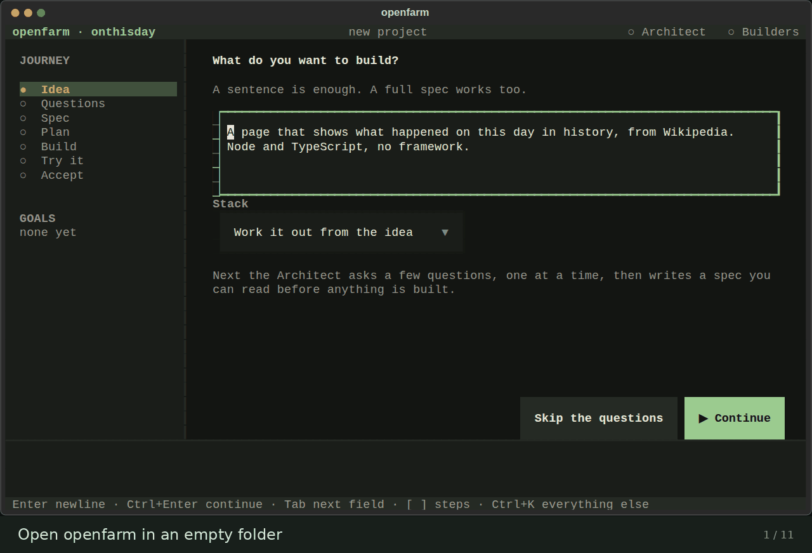

# openfarm

Your best model plans and reviews. Cheap models write the code. Plain code checks every step.

<p align="center">
  
</p>

*A real run: one sentence in, a tested web page out, three goals and eleven tasks later. The whole thing
happens in one terminal screen.*

## What it is

A frontier model is good at deciding what to build and at judging the result. It is a waste of money when it
sits in a loop fixing compile errors. openfarm splits the work along that line:

- **The Architect** (Claude or Codex, on the sign-in you already have) asks you a few questions, writes a spec,
  cuts it into goals, and cuts each goal into small tasks.
- **Builders** (any model behind an OpenAI-style API, the cheaper the better) write the tests for a task first,
  then the code, and retry against the compiler and the tests inside a fixed budget.
- **Plain Python** runs every check. No model gets to say its own work passed. Builders have no shell and can
  only change the files a task names.

You accept each task and each goal. Accepting merges on your machine. openfarm has no `git push` in it.

Version 0.20.0, pre-release. Python 3.11+, and the core has no dependencies outside the standard library.

## The seven steps

Run `openfarm` in a folder, empty or not. One screen shows the one thing that is yours to do next.

| Step | What happens | What you do |
| --- | --- | --- |
| **Idea** | You say what you want, in a sentence or a full spec. | Continue |
| **Questions** | The Architect asks a few questions, one at a time, with suggested answers. | Answer |
| **Spec** | A spec you can read in full, split into ordered goals. | Plan goal 1 |
| **Plan** | The goal becomes tasks. They are checked before you see them, and what can be repaired is repaired and shown. | Build |
| **Build** | Builders work in the background. A task that stops says which kind of stop it is and offers the fix that fits. | Accept each task |
| **Try it** | The app is started and looked at in a headless browser, at desktop and phone size. | Looks right, or Fix this |
| **Accept** | The goal's summary: tasks, tests, what trying it showed. | Accept the goal |

You can go back to any step you have reached, or to any goal, with `[` and `]`, the mouse or `Ctrl+K`. Looking
changes nothing, and `n` returns to the step that needs you. Closing the window does not stop a build.

Something wrong after a goal is accepted? "Something's wrong" turns what you say into fix tasks. "New feature"
adds a goal. Nothing already built is thrown away.

## Install

```bash
git clone https://github.com/grandprixgp/openfarm
cd openfarm
pip install -e ".[tui]"
```

You need Python 3.11+ and `git`, plus the usual tools for your project's language (for example `node` for
TypeScript or `cargo` for Rust). Try it needs a headless Chromium; `npx playwright install chromium` gets one.

Without `[tui]` you still get the command line, a plain `curses` screen, the web page and the agent skills.

## Set up

```bash
openfarm setup
```

It asks four things in order:

1. **Who plans and reviews.** Claude or Codex, through the sign-in you already use. If you are not signed in,
   it offers to do that now.
2. **Who builds.** OpenRouter, Fireworks, Together, a local Ollama, or any address that speaks the OpenAI chat
   API. The key goes in a file only you can read and is never printed.
3. **Which model builds.** It asks the address what it offers and lets you narrow the list by typing.
4. **Model and effort for each job.** Architect, reviewer and builders each get their own.

Every answer is also a flag, so the same command runs unattended:

```bash
openfarm setup --yes --frontier claude --preset openrouter --api-key "$KEY" \
    --builder-model qwen/qwen3-coder --architect-effort high --builder-effort medium
```

## Use it

```bash
mkdir on-this-day && cd on-this-day
openfarm
```

Type the idea and follow the screen. For a repository that already exists:

```bash
cd my-repo
openfarm adopt        # works out the language, runs your tests once, writes the config
openfarm              # then the same screen
```

Rust, Python, TypeScript and Go are supported.

## Models and effort

Each job can have its own model and its own effort, for one project or for all of them:

```bash
openfarm models                                   # what is in use, and where each choice comes from
openfarm models set architect --effort high       # this project
openfarm models set builder --model deepseek/deepseek-v4.1-flash --global
openfarm models catalogue                         # what each job can be given
```

The same thing is in the app: `Ctrl+K`, then "Models and effort". A choice for this project wins over one for
every project, and both win over the project's `config.toml`. More in [docs/models.md](docs/models.md).

## How a task is built

1. The task is checked against the project's rules, and gets its own branch and working copy.
2. Your test suite must be green before anything changes.
3. A builder writes the task's tests. They have to fail on the old code, and are then frozen.
4. A builder writes the code, touching only the files the task names. A retry gets more effort.
5. The checks run: the tests pass twice, the full suite, lint, no lost tests, the frozen tests untouched, a
   revert check, and a second model that tries to write a test that breaks the change.
6. It waits for you. Accepting merges the branch locally.

What stays true whatever a model says:

- Nothing is pushed. There is no code path for it.
- Builders cannot run commands, and cannot write outside the files a task lists.
- Files you mark as never to be touched are never shown to builders or changed.
- Keys live outside the repository in files only you can read, and are never logged.
- Requests only go to the addresses you allowed.

The internals are described in [docs/openfarm-internals.md](docs/openfarm-internals.md).

## Without the screen

Everything the screen does is also a command, each with `--json`:

```bash
openfarm run --follow          # build what is ready, carrying on into tasks that were waiting
openfarm daemon start          # the same, detached; `daemon status`, `daemon logs`, `daemon stop`
openfarm status                # where the project is
openfarm try                   # start the app and look at it
openfarm web --tailscale       # a page for your phone, on your own tailnet only
openfarm doctor --fix          # check the folder, the sign-ins and the settings
```

All 41 commands are listed in [docs/commands.md](docs/commands.md), and a full walkthrough of a first project
is in [docs/FROM-IDEA-TO-SHIPPED-APP.md](docs/FROM-IDEA-TO-SHIPPED-APP.md). Agents can drive openfarm through
the bundled skills (`openfarm install-skill`).

## Global learning

- Every project learns lessons from its own tasks. Each lesson is marked `project` or `general`. A lesson
  that names one of the project's files, functions or tasks stays `project`.
- A general lesson that has helped on 3 or more tasks, with fewer hurts than helps, goes to a library shared
  by your projects at `~/.openfarm/global/harness`, unless the project sets `share = false`.
  `[harness] global_dir` moves the library.
- Other projects try a shared lesson like one of their own. A project that finds it hurts switches it off
  for itself. Two such projects retire it everywhere.
- `[harness] learn_from = "both" | "project" | "global"` picks which lessons apply. The default is `both`,
  and `openfarm run --learn-from ...` overrides it for one run.
- `openfarm harness status --global` lists the shared lessons and where they came from.
  `openfarm harness demote <id> --global` retires one.
- A lesson passing between two live projects was seen working on 17 Nov 2026. Lessons building up over many
  tasks in two long-lived repositories is untested.

## Efficacy bench

`openfarm bench` measures whether the farm pays off with your own models. It ships 12 tasks (6 Rust, 6 Python)
with hidden tests the models never see, and runs each one two ways: the farm, and the frontier model doing
everything itself.

```bash
openfarm bench list
openfarm bench run --dry-run                      # scripted answers, costs nothing
openfarm bench run --arm farm=farm.toml --arm solo=solo.toml
```

In the 144-run bench of 19 Nov 2026 ([docs/bench-v0.8.7.md](docs/bench-v0.8.7.md)), with Claude as the
frontier model the farm passed 35 of 36 against 34 of 36 solo, on 37.5% fewer frontier tokens. With Codex it
passed 34 of 36 against 36 of 36, on 45.9% fewer. A 25-task pilot on a real Rust crate is in
[docs/pilot-v0.8.6.md](docs/pilot-v0.8.6.md).

## Configuration

Each project carries `.openfarm/config.toml`, written by `openfarm init` or `openfarm adopt`. An unknown table
or key is refused, so a typo cannot quietly switch a check off. The tables, budgets and stop codes are in
[docs/USAGE-AND-FIRST-DEPLOYMENT.md](docs/USAGE-AND-FIRST-DEPLOYMENT.md).

## What has been tested

- **The offline suite:** TESTCOUNT tests, all passing, on Python 3.14 and Linux. Some are skipped when a tool
  such as `tsc`, `ruff` or `bwrap` is not installed.
- **A live run on 21 Nov 2026:** a fresh TypeScript project taken from one sentence to three accepted goals
  inside the screen: 11 tasks, the project's 51 tests passing, Try it passing at desktop and phone size. The
  last goal's four tasks all passed first time. Of the tokens spent, builders used 67%, reviewers 25% and the
  Architect 7%. The recording at the top of this page is that project.
- **Earlier live runs** are listed in the [changelog](CHANGELOG.md).

Not tested yet:

- The app in a real light-coloured terminal, and the mouse in a real terminal. Both are covered by tests only.
- Real `go`, `vitest` and `jest` binaries. They are tested through stand-ins.
- Building on a provider other than Command Code. The presets are tested and OpenRouter's model list was read
  live, but whole projects have only been built on Command Code.
- Antigravity as the Architect. It only runs when a person starts it, so openfarm does not plan with it.
- Desktop notifications on a real desktop.

## What changed

0.20.0 lets you walk back through the journey, catches four more kinds of unbuildable task before Build, adds
`openfarm setup` and per-job models and effort, and counts the Architect's tokens. The full list for every
release is in [CHANGELOG.md](CHANGELOG.md).

## Contributing

Keep `openfarm_core/` on the Python standard library only, keep project-specific behaviour in config and
adapters, and send tests with every change. Run them from the repository root:

```bash
python3 -m unittest discover -s tests -t .
```

## Licence

<!-- TODO(maintainer): choose a licence, add a LICENSE file, and replace this section. -->

Not decided yet. Until a licence is added, no rights to use, copy or modify this code are granted.
