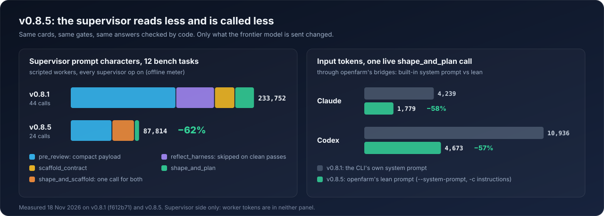

# openfarm v0.8.5 build log

v0.8.5 was built on 18 Nov 2026 on top of v0.8.1 (`f612b71`). It had three aims, in this order:

1. Make the supervisor cheaper in tokens.
2. Make `openfarm drive` (a CLI agent driving the seats) behave the same as ACP mode.
3. Fix every item on the v0.8.1 Known Limits list that code can fix.

Since `f612b71`, 63 files have changed: about 3,100 lines added and 200 removed, tests included. Cost is reported as token counts and shares, never as dollars.

  

## What I looked at first

I compared openfarm's supervisor calls with what other multi-agent coding setups do to save tokens, and kept four ideas:

- **Cut what the provider CLI sends on every call.** Claude Code and Codex each send a large built-in system prompt and tool list. openfarm's supervisor calls use no tools, so almost all of that is dead weight. I checked how to replace Codex's base instructions against Codex's own documentation, and then against the real CLI.
- **Mask old observations.** Send the model the facts a call needs, not whole records. Gate records were the biggest part of `pre_review`.
- **Fewer calls.** On the v0.8.1 bench, `shape_and_plan` said `ready` on all 58 cards. `scaffold_contract` then ran with the same card and signatures on every card that declared new symbols. And 41 of the 47 reflection calls were on cards that passed first try.
- **A cascade for workers.** Start a cheap model at a moderate effort, and spend more only when an attempt fails.

## Changes

| Area | Commit | What changed |
| --- | --- | --- |
| Lean prompts | `cd066bf` | openfarm's Claude and Codex bridges replace the CLI's built-in system prompt with a short one of openfarm's. Claude gets `--system-prompt` (never `--bare`, so the login still works). Codex gets `-c instructions=...` with its `include_*` extras off. `[micromanager] lean_prompt = true` by default. Skills, MCP servers and plugins on the machine are untouched, because only the bridge's own child gets these flags. |
| Compact payloads | `d539a75` | `compact_supervisor_payload` gives every backend the same smaller form. Local file paths are dropped, since no supervisor opens them. A gate that ran twice is shown once, as its last run. A passing gate is just its name, result and detail; evidence is kept only for gates that didn't pass and for the checker and counter-test gates. `drive` keeps the full question text. |
| No reflection on clean passes | `d539a75`, `275e63c` | `[harness] reflect_on = ["retry_recovery", "fail", "counter_fail"]`. A first-try pass is still recorded in the ledger; the supervisor just isn't asked to reflect on it. A card that handed back and passed after a hint still counts as a recovery. |
| One call for shape and scaffold | `6167414`, `275e63c` | New op `shape_and_scaffold`, used when a card needs both and the backend supports it (`[micromanager] combine_calls = true`). A refused scaffold is handled exactly as a refused `scaffold_contract`. An answer with no contract at all falls back to the separate call. |
| Drive: questions-only turns | `60c639f` | A drive turn with no coordinator work sends only the open questions, not the board, roster and card lists. |
| Drive defaults | `7b615e6` | With no `--model`, `--effort` or `--turn-timeout`, `drive` uses `[micromanager]`'s model and effort, as ACP mode does, when it is the same provider. Its wait is the longer of 180 s and `[micromanager] timeout_s`. |
| Worker effort on retries | `279c171` | `[roles.<role>] retry_effort` covers every attempt after the first. The DSF roles in this repository's config run `effort = "high", retry_effort = "max"`. A coordinator's effort change never goes below `retry_effort`. |
| Join error codes | `a8e3520` | JSON errors carry `"code"`, so a script can tell `seat-occupied` from `name-taken`. |
| Parametrized `known_failing` | `52cfdb2`, `275e63c` | A named test whose every pytest case is on `known_failing` is refused, by `check` and by the run alike. |
| Counter-tests past 64 MB | `420a6b2` | Ignored files over the in-memory cap are kept as hard links (or copies, within `min_free_mb`) and restored, instead of only being logged. |
| Lock and seat takeover | `9eba359` | A holder counts as gone only on the same machine, boot and pid namespace. A reused pid (a different start time) counts as gone. |
| Self-updating CLIs | `deba66f` | The bridges and `drive` retry a missing or busy provider program for about 15 s (`OPENFARM_SPAWN_RETRY_DELAYS`). |
| Symlinked `never_touch`, read roots | `22890bf` | A `never_touch` path reached through a symlinked folder is hidden too. A `confine_read_roots` entry that holds your home folder is refused. |
| Standalone `codex-acp` read-only | `4d22b55` | Refused up front where Codex's sandbox can't nest, as the bridge already was. |
| Parallel spend | `37227ed` | A test proving that each card books only its own supervisor spend (the code was already right). |
| Python and TypeScript mutation | `9506bc6`, `275e63c` | `openfarm_core/mutate.py`, openfarm's own mutation runner (standard library only). It mutates only the lines the card changed and runs the card's named tests against each mutant. The results land in `gates/mutation/N/outcomes.json`. |
| Runner boundary | `ce78bb8` | `[runner] confine = "bwrap"` runs builds and tests where only the worktree, its build folder and `confine_write_roots` can be written. Logins under home and the worker key are hidden. Off by default. |
| Version | `c2dd4dc` | 0.8.1 → 0.8.5 in the packaging, the skills and their packaged copies. |

## Measured

### Offline meter (12 bench tasks, scripted workers, every supervisor op on)

| | v0.8.1 (`f612b71`) | v0.8.5 |
| --- | ---: | ---: |
| Supervisor calls | 44 | 24 |
| Prompt characters | 233,752 | 87,814 (−62%) |
| `pre_review` | 133,995 (12 calls) | 52,795 (12 calls) |
| `reflect_harness` | 49,102 (12 calls) | 0 (every card passed first try) |
| `scaffold_contract` | 25,777 (8 calls) | merged |
| `shape_and_plan` | 24,878 (12 calls) | 6,478 (4 calls) |
| `shape_and_scaffold` | n/a | 28,541 (8 calls) |

The worker side is the same scripted answers in both columns, so the whole drop is on the supervisor side.

### Live, through openfarm's bridges (18 Nov 2026)

These are input tokens for one `shape_and_plan` call on the same card:

| Provider | Built-in system prompt | Lean prompt |
| --- | ---: | ---: |
| Claude | 4,239 | 1,779 (−58%) |
| Codex | 10,936 | 4,673 (−57%) |

One merged `shape_and_scaffold` call took 2,186 input tokens on Claude and 4,939 on Codex. That covers the work of two calls. Both providers answered `ready` with a correct `raise NotImplementedError` stub.

Command Code accepts `reasoning_effort = "high"` and `"max"` for DeepSeek V4.1 Flash and refuses junk values. On one real task, high and max thought for about the same number of tokens.

### Not measured

- A full live bench on v0.8.5, so there is no live worker-to-supervisor token share yet. Untested.
- `[runner] confine = "bwrap"` on a real project's build. Only the offline tests in a real bwrap have run it.
- The mutation runner on a large project. It ran on the test toys and on two small projects, with real node and Python.

## Tests

The offline suite on the final tree is in the README's [What's verified](../README.md#whats-verified) section. It was run twice: once with no optional tools, and once with ruff, pytest, tsc, prettier and cargo-mutants installed and `OPENFARM_E2E=1`. The `agy` stand-in was in place for both runs, and its call log stayed empty.
